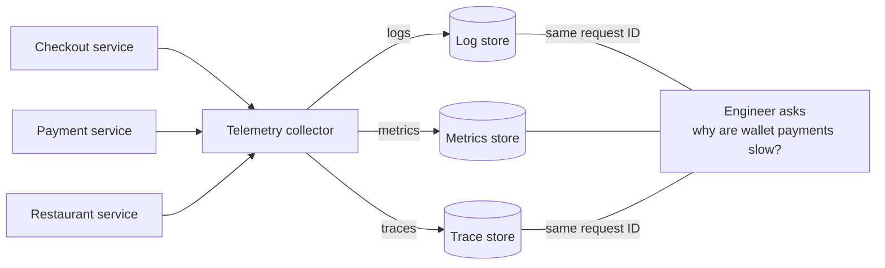

# Observability

> Observability is how well you can answer new questions about your system using only what it already emits. With good observability, the next weird outage takes ten minutes to explain, not three days and a new deploy.

## How it works

Your system emits three main kinds of signals:

- **Logs.** A line of text or JSON for each event, like "payment failed for order 1001".
- **Metrics.** Numbers counted over time, like requests per second or error rate. Cheap to keep and fast to graph.
- **Traces.** The path of one request through every service it touched, with timing for each hop.

Monitoring checks for problems you already know about: is the error rate over 1 percent, is the disk full. Observability is for the problems you didn't predict. "Why are checkouts slow only for Android users on version 5.2 who pay with a gift card?" No dashboard has that panel. You answer it by slicing your data by fields you never planned to graph.

That only works when each event carries rich context: user ID, app version, region, feature flag, and a request ID that ties logs, metrics, and traces together. Fields with millions of possible values, like user ID, are fine on logs and traces but blow up a metrics system. That's one reason you need more than one signal.

The tradeoff is cost. Keeping every event gets expensive fast, so teams sample traces and drop noisy logs, and accept that a few questions will go unanswered.

The catch: buying three tools doesn't make you observable. If your signals don't share a request ID and nobody tags events with useful fields, you have three disconnected piles of data and the same three day debugging session.

## Example

A food delivery app's checkout dashboard shows p99 latency (the time 99 out of 100 requests finish within) jumping from 400 ms to 2.5 seconds. CPU, memory, and error rate all look normal. Monitoring says something is wrong, but not what.

The on call engineer opens the tracing tool and groups slow checkouts by their fields. City: no pattern. App version: no pattern. Payment method: every slow request uses one wallet provider, and the slow step in each trace is the call to its API.

Twelve minutes from page to answer, with no new logging deployed. They flip the feature flag that hides that payment option and open a ticket with the provider.

## Picture it

Every service sends all three signals through one collector. Because they share request IDs and fields, the engineer can ask a question nobody built a dashboard for and get the answer from data that was already there.

## Related

[Logging](logging.md) · [Metrics](metrics.md) · [Distributed Tracing](distributed-tracing.md) · [Monitoring](monitoring.md) · [Production Incidents](../22-operations/production-incidents.md)

---

[← DDoS Protection](../17-web-security/ddos-protection.md) · [All concepts](../../README.md) · [Logging →](logging.md)
