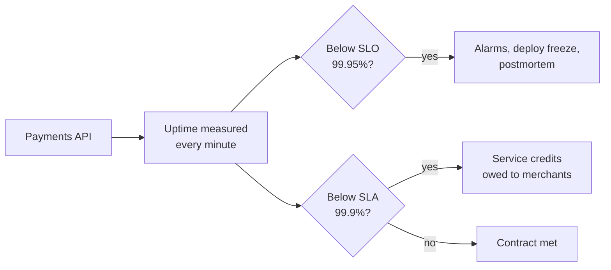

# SLAs

> A service level agreement is a contract that promises customers a level of service and spells out what you owe them if you miss it. It should always be looser than the target you hold yourself to internally.

## How it works

An SLA is a promise in writing, usually something like "99.9 percent monthly uptime", with a penalty attached. The penalty is almost always service credits: a discount on next month's bill. A typical schedule looks like this:

| Monthly uptime | Credit |
|---|---|
| Below 99.9% | 10% of the monthly fee |
| Below 99% | 25% |
| Below 95% | 100% |

The fine print decides what counts. Is any server error "down", or only full outages longer than 5 minutes? Is scheduled maintenance excluded? Does the customer have to file a claim within 30 days? Those details matter more than the headline number. AWS, Google Cloud, and Azure all publish SLAs that work roughly this way.

You also can't promise more than your dependencies give you. If your service needs three vendors that each promise 99.9 percent, the best you can honestly offer is about 99.7, because their outages add up.

And a credit is rarely real compensation. A customer who lost a day of sales gets 10 percent off one invoice, and cloud SLAs usually say credits are your only remedy.

The catch: never put your internal SLO in the contract. If both say 99.95 percent, the first time you miss your goal you also owe money, with no warning in between. Keep the SLA a step looser, like 99.9 against an SLO of 99.95, so you miss the internal target first and fix things while you still owe nobody anything.

## Example

A payments API sells to online merchants with an SLA of 99.9 percent monthly uptime. In a 30 day month, that allows 43 minutes of downtime before credits kick in. Internally, the team runs an SLO of 99.95 percent, which allows only about 22 minutes.

In June, a botched database failover (switching to the backup database) takes the API down for 30 minutes. The internal SLO is blown. Alarms fire, deploys freeze, and the team writes a postmortem. But the SLA still holds, so no merchant is owed a credit.

If the contract had promised 99.95 percent, those same 30 minutes would have cost 10 percent of every bill. With 800 merchants paying $2,000 a month, that's $160,000.

## Picture it

The same uptime number is checked against two lines. The internal SLO trips first and gets the team moving, while the contract line sits further down as a safety margin.

## Related

[SLOs](slos.md) · [SLIs](slis.md) · [Error Budgets](error-budgets.md) · [High Availability](../02-scaling/high-availability.md) · [Postmortems](../22-operations/postmortems.md)
