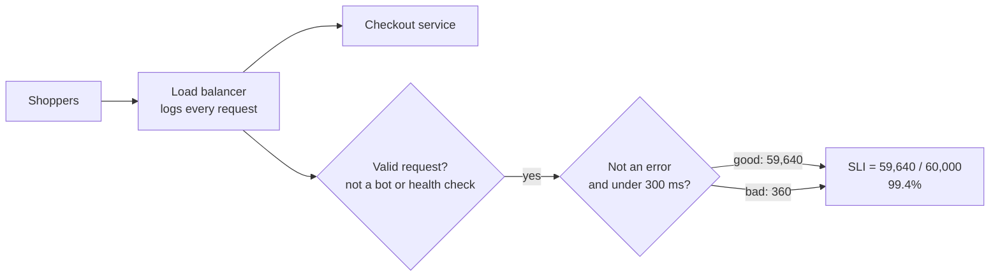

# SLIs

> A service level indicator is a number that measures how your service feels to users, like the percent of requests answered successfully in under 300 ms. Every reliability target is built on one.

## How it works

An SLI is almost always a ratio: good events divided by valid events, shown as a percentage. You decide what "good" means, count, and divide. Common ones:

- **Availability.** Requests that didn't fail, out of all requests. Usually "not a 5xx", meaning not a server error.
- **Latency.** Requests answered faster than a threshold, like 300 ms, out of all requests.
- **Freshness.** For data pipelines, the share of reads that see data less than 10 minutes old.
- **Correctness.** The share of results that are right, like payments that settle for the right amount.

Pick thresholds from what users notice, not from whatever your graphs happen to show today. Pick a few per user journey, like login, search, and checkout, not 40 per service.

Where you measure matters. Server logs miss requests that died at the load balancer, the CDN, or DNS, because those never reached your server. The load balancer is a common middle ground. Measuring in real browsers and apps is closest to the truth, but noisier.

Decide what counts as valid, too. Health checks from your own monitoring, bot traffic, and errors caused by bad client input usually don't count against you.

The catch: average latency makes a terrible SLI. An average of 200 ms can hide 2 percent of users waiting 4 seconds. A threshold ratio, "percent under 300 ms", counts every slow request.

## Example

An online store's checkout team picks one SLI: the percent of checkout requests, measured at the load balancer, that return a non error response in under 300 ms. Bots and health checks are excluded.

Last hour there were 60,000 valid checkout requests. 59,640 were good. The other 360 either failed or took longer than 300 ms. The SLI is 59,640 divided by 60,000, which is 99.4 percent.

The old dashboard showed an average latency of 140 ms and looked fine. The SLI shows that 0.6 percent of shoppers, about 360 people an hour, had a bad checkout. Now the team has a number they can set a target against.

## Picture it

The load balancer sees every checkout request. Each valid one gets sorted into good or bad, and the SLI is simply the good share.

## Related

[SLOs](slos.md) · [Error Budgets](error-budgets.md) · [P99 Latency](../01-performance/p99-latency.md) · [Metrics](metrics.md)
