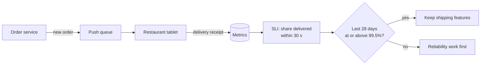

# SLOs

> A service level objective is the target you set for an SLI over a time window, like 99.9 percent of checkouts succeeding over 30 days. It turns "are we reliable enough?" into a yes or no question.

## How it works

An SLO has three parts: an SLI, a target, and a window. "99.9 percent of feed loads succeed in under 500 ms, over a rolling 30 days." Rolling means the window always covers the last 30 days, so a bad day counts against you for a month and then drops off.

Each extra nine shrinks how much failure you can afford:

| SLO | Full downtime allowed in 30 days |
|---|---|
| 99% | 7.2 hours |
| 99.9% | 43 minutes |
| 99.99% | 4.3 minutes |
| 99.999% | 26 seconds |

Each nine usually costs a lot more than the last: more regions, more automation, faster on call response. And past a point, users can't tell the difference, because their own wifi and phone signal fail more often than your service does.

Set the target from what users need and close to what you achieve today, not from what sounds impressive. Different journeys deserve different SLOs. Checkout might need 99.95 percent, while the recommendations widget is fine at 99.

The SLO is an internal goal, kept tighter than anything you promise customers in a contract. When you meet it, you're reliable enough and can spend effort on features. When you miss it, reliability work goes first.

The catch: a 100 percent SLO. It sounds responsible, but it means every deploy, every experiment, and every network blip counts as a failure. Teams that aim for 100 either stop shipping or quietly start ignoring the target.

## Example

A food delivery app sends new orders to restaurant tablets. The SLI is the percent of orders that reach the tablet within 30 seconds. Last quarter it measured 99.7 percent.

The product lead asks for 99.99 percent. Getting there would mean a second region and engineers on call around the clock, for a gain restaurants would never notice.

The team settles on 99.5 percent over a rolling 28 days. With 4 million orders in that window, that's room for 20,000 late ones. When a bad week drags them to 99.4 percent, the next sprint goes to fixing the tablet's reconnect logic instead of new features.

## Picture it

The system produces the SLI, and the SLO is the line it gets compared against. Above the line, the team ships features. Below it, reliability jumps to the front of the queue.

## Related

[SLIs](slis.md) · [Error Budgets](error-budgets.md) · [SLAs](slas.md) · [High Availability](../02-scaling/high-availability.md) · [Goodhart's Law](../23-laws/goodharts-law.md)
