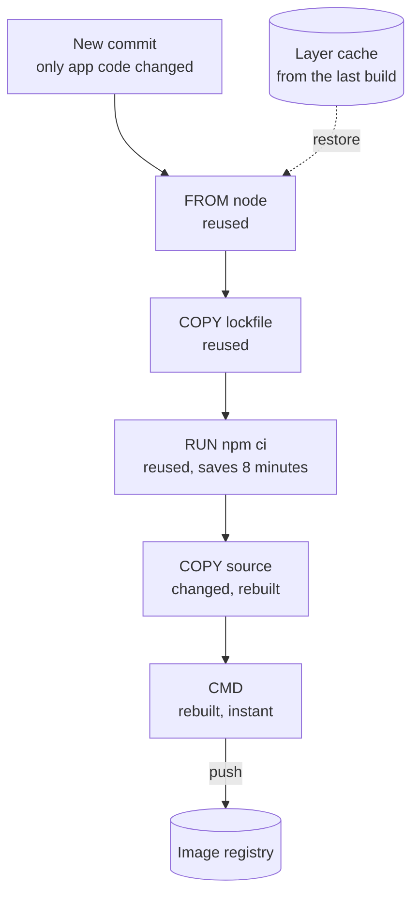

# Build Caching

> Build caching skips every step whose inputs did not change and reuses the saved output. It turns a 10 minute build into a 90 second one, as long as you order the steps so the cache can actually hit.

## How it works

Every build step takes inputs and produces outputs. If the inputs are byte for byte the same as last time, the output will be too, so you can skip the work and grab the saved result. The tool hashes the inputs, uses the hash as a cache key, and looks it up.

This shows up in three places:

- **Docker layers.** Each instruction in a Dockerfile makes a layer. If an instruction and everything above it is unchanged, Docker reuses the cached layer. Change one line and every line below it rebuilds.
- **CI dependency caches.** CI machines start empty, so they download every package on every run. Save the package folder under a key made from the lockfile's hash, and restore it next run. A new lockfile means a new key.
- **Remote build caches.** Tools like Bazel, Gradle, Nx, and Turborepo store the output of each step on a shared server. If a teammate or CI already built that exact module, you download the result instead of building it again.

Layer order is the big knob. Put what rarely changes at the top: the base image, system packages, dependencies. Put what changes on every commit, your source code, at the bottom.

Watch out: a cache key that misses an input. If the key ignores an environment variable or a compiler version that changes the output, you get a stale result that looks fresh. The build passes in CI, fails on a clean machine, and nobody can explain why.

## Example

An online store's Node.js app takes 10 minutes to build in CI. The CI runner keeps Docker's layer cache between builds, but the Dockerfile copies the whole repo first, then installs packages. Every commit changes some file, so the copy layer changes, and Docker reinstalls all 900 packages on every single build.

The fix is to reorder. Copy only the package list and lockfile, install, and then copy the source. Now a normal commit rebuilds just the last two layers, and the build drops to about 90 seconds. It only takes the slow path when someone actually adds a package.

```dockerfile
FROM node:20-slim
WORKDIR /app
COPY package.json package-lock.json ./
RUN npm ci
COPY . .
CMD ["node", "server.js"]
```

## Picture it



Docker walks the layers top to bottom and reuses each one until it reaches the first change. Because the source code is copied last, the slow install stays cached and only the cheap layers at the bottom rebuild.

## Related

[CI/CD](ci-cd.md) · [Docker](docker.md) · [Dependency Hell](dependency-hell.md) · [Caching](../06-caching/caching.md)

---

[← CI/CD](ci-cd.md) · [All concepts](../../README.md) · [Dependency Hell →](dependency-hell.md)
