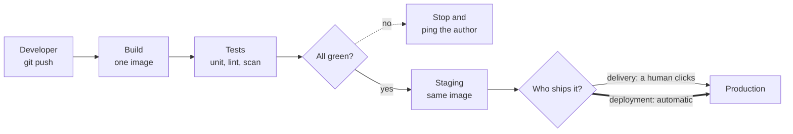

# CI/CD

> CI/CD is a pipeline that builds and tests every change the moment you push it, then ships the ones that pass. Small changes go out many times a day instead of one scary release a month.



## How it works

Continuous integration, or CI, means every push to the shared repo triggers a build and the full test suite on a clean machine. If anything fails, the author hears about it in minutes, while the change is still fresh in their head. The goal is a main branch that always works.

Continuous delivery goes one step further. Every green build is packaged and ready to ship, and a human clicks one button to release it. Continuous deployment removes the button: every change that passes the pipeline goes to production on its own.

A typical pipeline runs in stages, and each one starts only if the one before it passed:

1. **Build.** Compile the code and produce one artifact, like a Docker image.
2. **Test.** Run unit tests, linters, and security scans in parallel.
3. **Stage.** Deploy that artifact to a staging environment and run end to end tests against it.
4. **Release.** Promote the exact same artifact to production, often to a small slice of traffic first.

The rule that holds it together is build once, deploy many. The image you tested in staging is the same bytes that reach production. Rebuild it per environment and you ship something nobody tested.

The catch: a slow or flaky pipeline kills the whole idea. If tests take 45 minutes, or fail at random one run in five, people start batching changes and clicking "rerun" until it goes green. Keep the pipeline under about 10 minutes, and fix or delete a flaky test the day it shows up.

## Example

A SaaS dashboard team of 8 engineers releases once every two weeks, about 60 changes at a time. When a chart breaks, nobody knows which of the 60 did it, and rolling back throws away two weeks of good work too.

They set up a pipeline in GitHub Actions. Every pull request runs the build and 1,200 tests in 7 minutes. Merging to main deploys to staging, runs smoke tests, then deploys to production. Now they ship about 15 small releases a day. When a chart breaks, the culprit is one change of 40 lines, and reverting it takes 5 minutes.

```yaml
on: [push]
jobs:
  test:
    runs-on: ubuntu-latest
    steps:
      - uses: actions/checkout@v4
      - run: npm ci
      - run: npm test
```

## Picture it



Every push walks the same path, and a red test stops it early. The only difference between delivery and deployment is the last arrow: a person presses the button, or the pipeline presses it for you.

## Related

[Build Caching](build-caching.md) · [Docker](docker.md) · [GitOps](gitops.md) · [Canary Releases](../20-releases/canary-releases.md) · [Rollbacks](../20-releases/rollbacks.md)

---

[← Error Budgets](../18-observability/error-budgets.md) · [All concepts](../../README.md) · [Build Caching →](build-caching.md)
