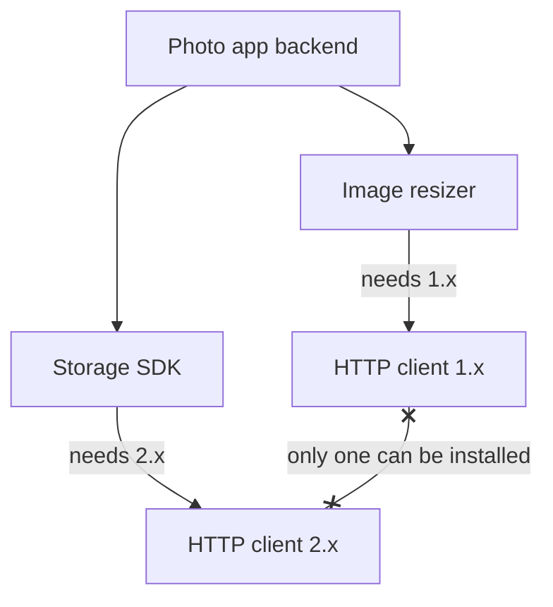

# Dependency Hell

> Dependency hell is when the libraries you use need different, incompatible versions of the same library underneath. Your own code is fine, but the app will not install, will not build, or breaks in places you never touched.

## How it works

You install 10 packages. Each of those has its own dependencies, and those have theirs. These are transitive dependencies: the ones you never asked for but get anyway. A web app with 20 direct dependencies can easily end up with 800 packages installed.

Trouble starts when they disagree:

- **Version conflict.** Your app needs an auth library at version 3, but the payment SDK you just added only works with version 2.
- **Diamond dependency.** Libraries A and B both depend on library C, but on different major versions. Your app sits at the top of the diamond and may only be allowed one copy of C.
- **Silent drift.** Your config says "any 2.x version". Yesterday that meant 2.4.0. Today 2.5.0 is out with a bug, and a fresh install picks it up without anyone changing a line.

Ecosystems handle the diamond differently. npm can install two copies of C side by side. Python and Java load only one version of a package at a time, so the tool has to pick one, or refuse to install.

The fix for drift is a lockfile, like `package-lock.json`, `poetry.lock`, or `Cargo.lock`. It records the exact version of every package in the tree, transitive ones included, so every laptop and every CI run installs identical code. Commit it.

The catch: a lockfile freezes bugs and security holes too. If nobody updates it, you drift 3 major versions behind and the upgrade becomes a project. Tools like Dependabot and Renovate open small update pull requests on a schedule you pick, like weekly, so you never fall that far behind.

## Example

A photo sharing app's Python backend uses an image resizing library and a cloud storage SDK. Both depend on the same HTTP client, and Python can only install one copy of it. The team has no lockfile.

On Monday the storage SDK releases an update that requires HTTP client 2.0. The next CI build pulls it in, upgrades the client, and the resizer starts crashing on every upload. The resizer claimed it worked with "1.0 or newer", but 2.0 renamed a function it calls. Nobody on the team changed a line of code.

The fix: pin the SDK to the last version that worked, commit a lockfile so every machine installs the exact same tree, and open a ticket to upgrade the resizer once it supports 2.0.

## Picture it

This is the diamond. The app is on top, two libraries sit in the middle, and they disagree about the one at the bottom. Only one copy can be installed, so one of the middle libraries is going to break.

## Related

[Semantic Versioning](semantic-versioning.md) · [Build Caching](build-caching.md) · [CI/CD](ci-cd.md) · [Docker](docker.md)

---

[← Build Caching](build-caching.md) · [All concepts](../../README.md) · [Semantic Versioning →](semantic-versioning.md)
