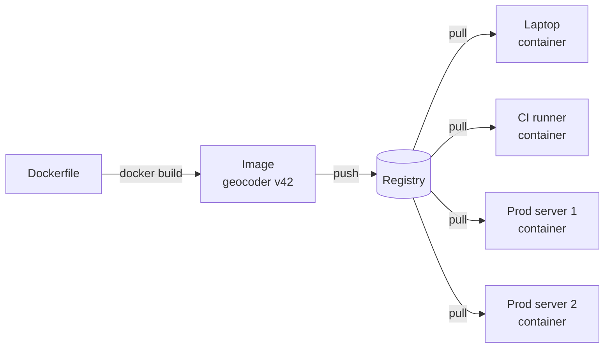

# Docker

> Docker packs your app, its runtime, and every library it needs into one image that runs the same on your laptop, in CI, and in production. It is the fix for "works on my machine".

## How it works

Your app works on your laptop because your laptop has Python 3.12, a certain version of some C library, and an environment variable you set two years ago and forgot about. The server has none of that. Docker fixes this by shipping the environment along with the code.

Two words matter:

- **Image.** A read only bundle: a slim slice of an operating system, your runtime, your dependencies, your code, and the command that starts it. You build it once, and it never changes.
- **Container.** A running copy of an image. You can start 50 containers from one image, the way one recipe makes many cakes.

You write the recipe in a Dockerfile. Each instruction adds a layer, and layers are cached and shared. If 10 images use the same base, the base is downloaded once. Built images go to a registry like Docker Hub, and servers pull them from there.

A container is not a virtual machine. A VM boots a whole operating system with its own kernel, which takes time and gigabytes of memory. A container is a normal process that the host's kernel walls off with its own view of files, network, and other processes. It starts in about a second.

Watch out: containers are disposable. Anything written inside one disappears when it is replaced, and in production that happens on every deploy. Databases, uploads, and anything you want to keep belong in a volume, an object store, or a managed service, never inside the container itself.

## Example

A food delivery app has a Python service that turns addresses into map coordinates. A new engineer spends their whole first day installing the right Python and a geometry library that needs a specific C library underneath. Production has a slightly different version of that C library, and every few weeks a deploy breaks in a way nobody can reproduce locally.

With a Dockerfile, the environment is written down once. Laptops, CI, and production all run the same image, built once and tagged with the commit. The new hire runs one command and is coding by lunch.

```dockerfile
FROM python:3.12-slim
RUN apt-get update && apt-get install -y libgeos-dev
WORKDIR /app
COPY requirements.txt .
RUN pip install -r requirements.txt
COPY . .
CMD ["python", "server.py"]
```

## Picture it



One Dockerfile builds one image. Every machine pulls those same bytes from the registry and runs them as a container, so the laptop and the production server finally agree on what the app needs.

## Related

[Kubernetes](kubernetes.md) · [Build Caching](build-caching.md) · [CI/CD](ci-cd.md) · [Stateless Services](../02-scaling/stateless-services.md) · [Twelve Factor App](../24-principles/twelve-factor-app.md)
