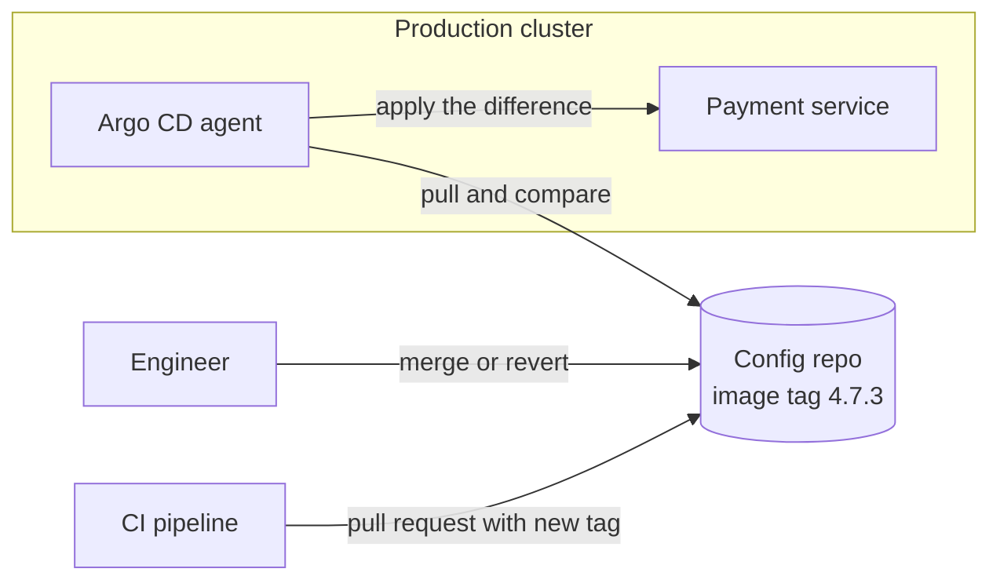

# GitOps

> GitOps makes a git repo the single source of truth for what runs in production. An agent inside the cluster keeps pulling that repo and making the cluster match, so deploying is a merge and rolling back is a revert.



## How it works

In a classic pipeline, CI pushes to production: it holds the cluster's credentials and runs `kubectl apply` at the end. GitOps flips the direction. A config repo holds the exact manifests for every environment, image tags included. An agent running inside the cluster, usually Argo CD or Flux, watches that repo and pulls.

Every few minutes, or right away when a webhook fires, the agent compares the cluster with the repo. If they differ, it applies the difference. This loop is called reconciliation, and it never stops:

- **Deploy.** CI builds an image and opens a pull request that bumps the tag in the config repo. Merge it, and the agent rolls it out.
- **Rollback.** Revert the commit. The agent sees the old tag and rolls back. No special tooling, no digging for what was there before.
- **Audit.** Who deployed what, when, and who approved it is just git history.
- **Drift repair.** Flux on plain manifests, or Argo CD with self heal turned on, notices a change someone made by hand with `kubectl` and puts it back to match git.

A nice side effect: CI never needs production credentials, so a breach of your CI provider cannot reach the cluster directly.

The catch: secrets. The repo is the truth, but database passwords cannot sit in git in plain text. Encrypt them with a tool like Sealed Secrets or SOPS, or have the cluster fetch them from a secrets manager. Also, tell your team about drift repair before an incident. A hotfix applied by hand will be quietly undone on the next sync, so pause syncing or make the fix in git.

## Example

A wallet app's payment service deploys a new version at 4:10 PM. By 4:14, failed transfers jump from 0.1 percent to 6 percent. The engineer on call does not need cluster access, a deploy tool, or the old version number. They open the config repo and revert the last commit:

```diff
-        image: wallet/payments:4.8.0
+        image: wallet/payments:4.7.3
```

Argo CD picks up the revert on its next sync and rolls the deployment back to the previous image. Errors are back to normal by 4:19. The revert, the approval, and every timestamp are in git, which is exactly what the auditors ask for next quarter.

## Picture it



Nothing pushes into the cluster. The agent inside reaches out to the repo, compares, and applies the difference, so whatever git says is what runs, and a revert in git is a rollback in production.

## Related

[Infrastructure as Code](infrastructure-as-code.md) · [Kubernetes](kubernetes.md) · [Helm Charts](helm-charts.md) · [CI/CD](ci-cd.md) · [Rollbacks](../20-releases/rollbacks.md)

---

[← Terraform](terraform.md) · [All concepts](../../README.md) · [Feature Flags →](../20-releases/feature-flags.md)
