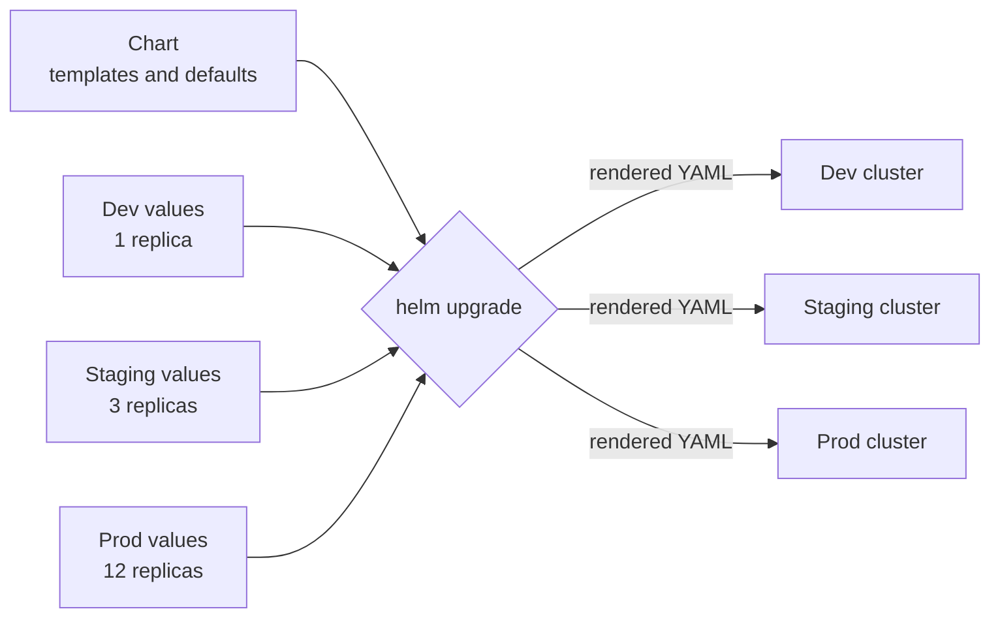

# Helm Charts

> A Helm chart is a package of Kubernetes YAML with blanks to fill in. You write the manifests once, then install the same chart in dev, staging, and production with different values for each.



## How it works

A real app on Kubernetes needs a pile of YAML: a deployment, a service, a config map, an ingress, an autoscaler. Copying that pile for each environment and editing it by hand goes wrong fast. Someone raises the memory limit in staging and forgets production.

Helm turns the pile into a chart, which is a folder with three main parts:

- **Templates.** The manifests, with placeholders like `{{ .Values.replicas }}` wherever environments differ.
- **Values file.** Defaults for every placeholder live in `values.yaml`. Each environment adds a small override file with only what changes.
- **Chart metadata.** A name and a version number, so a chart can be published, shared, and pinned like any other package.

`helm install` fills in the templates and sends the result to the cluster. Each install becomes a release with a numbered history, so `helm upgrade` moves you forward and `helm rollback` takes you back to an earlier revision.

Charts are also how people share software. Need Redis, Postgres, or Prometheus in your cluster? Someone has already published a chart, and you only set the values you care about.

The catch: templates are text with logic mixed in, and they get messy. A chart full of nested `if` blocks and loops turns into a program written in YAML, and it gets hard to tell what will actually be deployed. Run `helm template` to see the final YAML before you ship, and review that, not just the values.

## Example

A chat app runs its message service in three environments. Dev needs 1 replica and a small database. Production needs 12 replicas with 2 GiB of memory each, and autoscaling on. Before Helm, the team kept three folders of nearly identical YAML, and they drifted apart: a health check fix landed in staging and never reached production.

Now there is one chart and three short values files. Production's file is a handful of lines, and shipping a new version anywhere is the same command with a different file.

```yaml
# values-prod.yaml
replicas: 12
image:
  tag: "2.14.0"
memory: 2Gi
autoscaling:
  enabled: true
```

```
helm upgrade chat ./chart -f values-prod.yaml
```

## Picture it



One chart holds the templates. Each environment brings its own small values file, Helm fills in the blanks, and every cluster gets YAML built from the same source instead of a hand edited copy.

## Related

[Kubernetes](kubernetes.md) · [GitOps](gitops.md) · [Semantic Versioning](semantic-versioning.md) · [Infrastructure as Code](infrastructure-as-code.md) · [Rollbacks](../20-releases/rollbacks.md)

---

[← Kubernetes](kubernetes.md) · [All concepts](../../README.md) · [Infrastructure as Code →](infrastructure-as-code.md)
