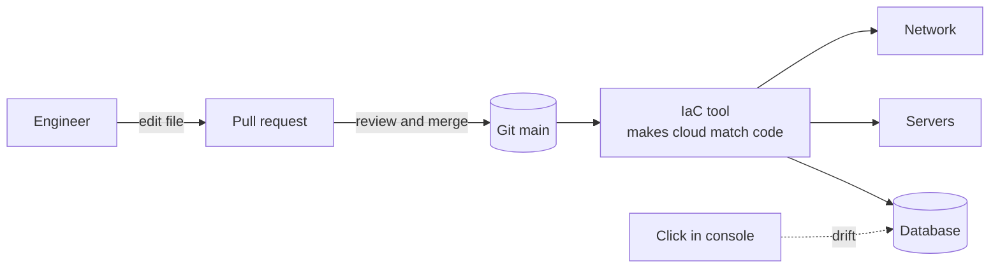

# Infrastructure as Code

> Infrastructure as code means your servers, networks, and databases are described in text files that live in git. You change infrastructure by changing code, and anyone can rebuild the whole setup from scratch.

## How it works

The old way is click ops: someone logs into the cloud console, clicks through 14 screens, and makes a database. It works. Six months later nobody knows which settings were picked, why, or how to make a second one that matches.

With infrastructure as code, you write a file that says "a Postgres 16 database, 100 GB, in a private network, backups on". A tool reads the file and makes the cloud match it. That buys you four things:

- **Review.** Infrastructure changes go through pull requests like app code. A teammate spots "this opens the database to the internet" before it happens, not after.
- **History.** Git shows who changed what, and why. Undoing a bad change means reverting a commit.
- **Reproducibility.** Staging and production come from the same code, so they really match. A new region is a new variables file, not a week of clicking.
- **Recovery.** If an account is wiped, the code to rebuild everything still exists.

Most tools are declarative. Terraform, CloudFormation, and Pulumi describe the end state and work out the steps themselves. Running them twice is safe, because the second run finds nothing to change. A shell script that lists the steps does not have that property, and running it twice often breaks things.

The catch: drift. Someone fixes an outage at 2 AM by changing a setting in the console. Now the real infrastructure no longer matches the code, and the next run either quietly undoes the fix or fails in a confusing way. Make the console read only for humans, and run the tool on a schedule to report drift.

## Example

A ticketing site's production setup was built by hand over three years. Before a huge concert sale, the team wants an identical copy to load test against. It takes two engineers nine days, and the copy still differs in a dozen small ways: a missing firewall rule, an older database version, a cache half the size.

After they move everything into code, a new environment is one command and about 25 minutes. The load test copy matches production because it is production's code with different names. When the test is done, they tear it down with one more command and stop paying for it.

## Picture it

Every change should travel the solid path: a file, a review, a merge, and a tool that makes the cloud match. The dotted arrow is drift, a change made by hand that the code knows nothing about.

## Related

[Terraform](terraform.md) · [GitOps](gitops.md) · [Disaster Recovery](../21-disaster-recovery/disaster-recovery.md) · [CI/CD](ci-cd.md)
