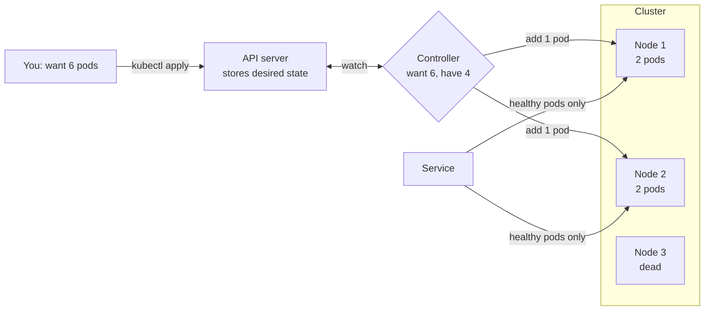

# Kubernetes

> Kubernetes runs your containers across a fleet of machines. You write down what you want, like "6 copies of this service, always", and it keeps working until reality matches, even when machines die.

## How it works

You never tell Kubernetes "start this container on server 3". You hand it a description of the desired state, usually a YAML file, and it saves that in its own database. Small programs called controllers then loop forever: compare what you asked for with what is actually running, and fix the difference. A crashed container gets restarted. A dead machine's work gets moved to a healthy one.

Three objects do most of the work:

- **Pod.** One or more containers that run together on the same machine and share a network address. It is the smallest thing Kubernetes schedules.
- **Deployment.** Says "keep 6 pods of this image running". Change the image tag and it rolls out new pods a few at a time, retiring the old ones as it goes.
- **Service.** A stable name and address in front of a changing set of pods. Pods come and go with new IPs, and the service always knows the current healthy ones and spreads traffic across them.

On top of that you get autoscaling, health checks that restart stuck containers, and config and secrets handed to containers at startup.

The catch: Kubernetes is a whole platform, and you pay for it in people. Someone has to upgrade the cluster, understand its networking, and debug it at 3 AM. With 3 services and 4 engineers, a managed platform like Cloud Run or Heroku, or even one VM running Docker, gives you most of the benefit for a fraction of the work. Kubernetes pays off when you have dozens of services and a team that can run it.

## Example

A video streaming site runs its transcoding service as a Deployment with 6 pods spread over 3 machines. At 2 AM one machine's disk fails, the machine drops offline, and 2 pods go with it.

Nobody gets paged. Within about a minute, Kubernetes marks the machine as unhealthy, and the Service stops sending traffic to its 2 pods. By default it then waits 5 more minutes in case the machine comes back. After that, the controller sees 4 running pods where the spec says 6 and starts 2 new ones on the surviving machines. Soon the cluster matches the YAML again, and the team reads about it over coffee.

## Picture it

Node 3 died and took 2 pods with it. The controller spots the gap between 6 wanted and 4 running and adds pods to the healthy nodes, while the Service stops sending traffic to the dead one. Nobody typed a command.

## Related

[Docker](docker.md) · [Helm Charts](helm-charts.md) · [GitOps](gitops.md) · [Liveness and Readiness Probes](../14-reliability/liveness-and-readiness-probes.md) · [Autoscaling](../02-scaling/autoscaling.md)

---

[← Docker](docker.md) · [All concepts](../../README.md) · [Helm Charts →](helm-charts.md)
