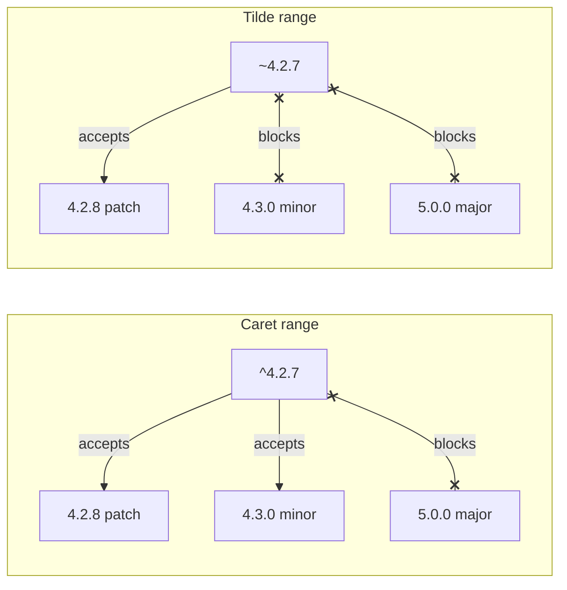

# Semantic Versioning

> Semantic versioning packs a promise into a version number: MAJOR.MINOR.PATCH. Which number moved tells everyone downstream whether upgrading is safe or will break their code.

## How it works

A version like `4.2.7` has three parts, and each bump promises something different:

| Bump | Example | Promise |
|---|---|---|
| PATCH | 4.2.7 to 4.2.8 | Bug fixes only. Nothing you rely on changes. |
| MINOR | 4.2.8 to 4.3.0 | New features. Old code keeps working. |
| MAJOR | 4.3.0 to 5.0.0 | Breaking changes. Read the notes first. |

Bumping one part resets everything to its right to zero.

Package managers read these numbers to pick versions for you. In npm, a caret range `^4.2.7` accepts anything from 4.2.7 up to, but not including, 5.0.0. A tilde range `~4.2.7` is stricter: 4.2.7 up to 4.3.0, so patches only. Caret is what npm writes by default, which means you trust every library author to never sneak a breaking change into a minor release.

Below 1.0.0 it is a free for all. The spec says anything may change at any time in 0.x, because the project is still finding its shape. npm plays it safe here: `^0.3.1` accepts 0.3.1 and later 0.3 releases but never 0.4.0, since in 0.x a minor bump is allowed to break things.

The catch: semver is a promise made by a human, not a check made by a machine. Authors break things in patch releases by accident all the time, often by fixing a bug someone was relying on. Ranges keep you current, a lockfile keeps you stable, and only your tests tell you whether an upgrade actually works.

## Example

A payments API ships an SDK. Version 2.4.0 adds an optional `metadata` field on charges. That is a MINOR bump: a new feature, and old code is untouched.

Next, the team decides `amount` should be in cents instead of dollars. Every existing caller passing `amount: 10` would suddenly charge 10 cents instead of 10 dollars. That has to be 3.0.0, with a migration guide.

Now imagine they ship it as 2.5.0 instead. Every merchant with this in their config pulls it in the next time they update or install without a lockfile, with no warning and no code change:

```json
"payments-sdk": "^2.4.0"
```

Charges come out 100 times too small until someone notices the revenue graph. The version number was the only warning those merchants would have gotten, and it lied.

## Picture it



Caret lets in patches and minors but stops at the next major. Tilde lets in only patches. Neither one can stop an author who ships a breaking change with the wrong number.

## Related

[Dependency Hell](dependency-hell.md) · [API Versioning](../05-apis/api-versioning.md) · [Schema Versioning](../07-databases/schema-versioning.md) · [CI/CD](ci-cd.md)
