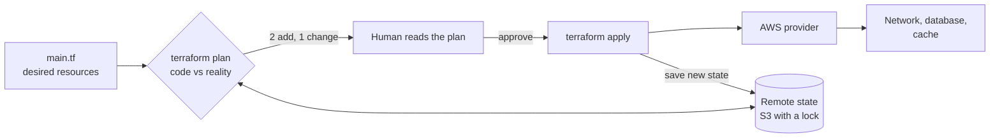

# Terraform

> Terraform is a widely used tool for infrastructure as code. You describe cloud resources in config files, it shows you a plan of exactly what will change, and only then does it make the change.



## How it works

You write resources in HCL, Terraform's config language: a database here, a bucket there, a DNS record pointing at a load balancer. Providers are plugins that each know how to talk to one API. There are providers for AWS, Google Cloud, Azure, Cloudflare, GitHub, and thousands more. OpenTofu, an open source fork of Terraform, works the same way.

The workflow has two steps:

1. **Plan.** `terraform plan` compares your code with what exists and prints a diff, like "2 to add, 1 to change, 0 to destroy".
2. **Apply.** `terraform apply` asks you to confirm the plan, then makes those changes in the right order, because Terraform knows the network must exist before the database inside it.

To know what exists, Terraform keeps a state file. It maps each resource in your code to a real ID in the cloud. Without it, Terraform cannot tell "create a new database" apart from "that database already exists".

By default the state file sits on your laptop, which breaks the moment a second person runs Terraform. So teams keep it in remote storage, like an S3 bucket, with locking turned on. The lock means only one apply can run at a time, so two people cannot overwrite each other's state.

The catch: read the plan. A line saying a database "must be replaced" means destroy and recreate, and your data goes with it. Also, state can hold secrets in plain text, like database passwords. Encrypt the bucket, limit who can read it, and never commit state to git.

## Example

A social feed team runs Terraform from their laptops, with the state file in a shared folder. Two engineers run `apply` at the same moment. One adds a cache, the other resizes the database. Each run writes its own copy of the state, and the second overwrites the first. Now Terraform has no record of the cache. The next plan wants to create it again, and the apply fails because the name is taken.

They move state to S3 with locking. Now a second apply stops with "Error acquiring the state lock" and says who holds it. Plans also run in CI on every pull request, so reviewers see the diff before they approve.

```hcl
terraform {
  backend "s3" {
    bucket       = "feed-terraform-state"
    key          = "prod/terraform.tfstate"
    region       = "us-east-1"
    encrypt      = true
    use_lockfile = true
  }
}
```

## Picture it



Terraform reads your code and the state file, then shows a diff before touching anything. Only after a human approves does apply call the provider, and the state is saved so the next plan knows what exists.

## Related

[Infrastructure as Code](infrastructure-as-code.md) · [GitOps](gitops.md) · [Secrets Management](../16-identity-and-encryption/secrets-management.md) · [Distributed Locks](../11-coordination/distributed-locks.md)

---

[← Infrastructure as Code](infrastructure-as-code.md) · [All concepts](../../README.md) · [GitOps →](gitops.md)
