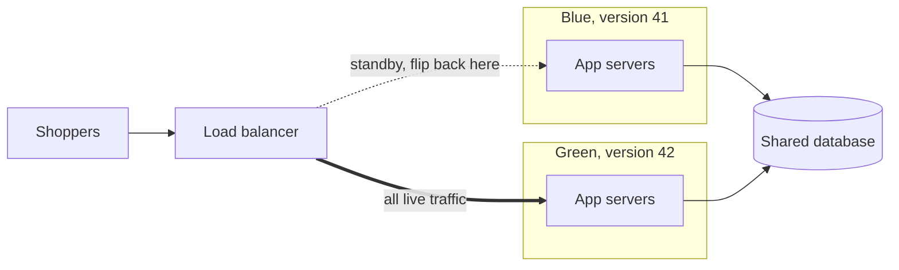

# Blue Green Deployment

> Blue green deployment runs two full copies of production. You deploy to the idle one, test it, then flip all traffic over at once, and flipping back is just as fast.

## How it works

You keep two identical environments, called blue and green. Right now blue is live and green sits idle. You deploy the new version to green and run smoke tests against it, quick checks that the key pages and APIs work, while no real users are on it. Then you switch the load balancer to send all traffic to green. Blue keeps running the old version, untouched.

If green misbehaves, you flip back. That's the whole appeal: a rollback in seconds, because the old version never went away. On the next release, the roles swap and blue gets the new code.

The tradeoffs:

- **Cost.** You pay for two full environments, at least around each release.
- **All at once.** Every user moves at the same moment. A bug hits everyone, unlike a canary that starts with 1%.
- **No mixed versions.** Unlike a rolling deploy, old and new code don't serve users side by side.

How you flip matters. Swapping the load balancer's target is close to instant. Switching DNS is slower, because clients cache the old address until its time to live runs out.

The catch: the database. Blue and green almost always share one, because copying live data between two databases on every release isn't practical. So the new schema has to work with the old code, or flipping back breaks. If green's release drops a column that blue reads, your instant rollback crashes on arrival. Ship schema changes that are backward compatible, and ship them in an earlier release than the code that needs them.

## Example

An online store is about to start a big sale. Blue serves version 41. The team deploys version 42 to green, runs 200 automated checkout tests against it, and flips the load balancer at 9:00.

By 9:04, payment errors climb from 0.2% to 6%. A config typo points green at the payment provider's sandbox. The on call engineer flips the load balancer back to blue, and errors are normal by 9:05. Green stays up, with no users on it, so the team can debug it calmly.

The flip back worked because the release's one schema change, a new optional `gift_message` column, had shipped a week earlier on its own. Blue's code never noticed it was there.

## Picture it

All traffic goes to green, while blue waits one switch away. Both environments talk to the same database, which is why every schema change has to work for both versions.

## Related

[Rolling Deployments](rolling-deployments.md) · [Canary Releases](canary-releases.md) · [Rollbacks](rollbacks.md) · [Database Migrations](../07-databases/database-migrations.md) · [Load Balancing](../03-traffic/load-balancing.md)

---

[← Rolling Deployments](rolling-deployments.md) · [All concepts](../../README.md) · [Canary Releases →](canary-releases.md)
