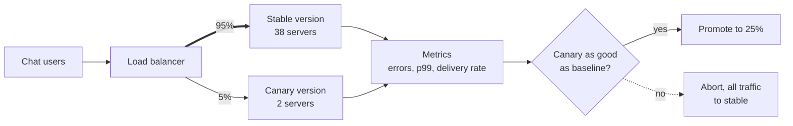

# Canary Releases

> A canary release sends a small slice of real traffic, like 5%, to the new version and compares its numbers with the old one. If the canary looks sick, you pull it before most users ever see it.

## How it works

The name comes from coal mines, where miners carried a canary. If the bird got sick, the air was bad, and everyone got out.

You deploy the new version to a few servers next to the old ones and route a small share of traffic to them. Then you compare the canary with a baseline, the old version serving the same kind of traffic at the same time. Look at error rate, p99 latency, CPU, and at least one business number, like checkouts or messages delivered. If they match, you raise the share: 25%, 50%, 100%. If not, you send that slice back, and the other 95% never noticed.

The knobs:

- **Slice size.** Big enough to give a clear signal, small enough to limit damage. On a quiet service, 1% might be a handful of requests an hour, which tells you nothing.
- **Bake time.** How long each step runs. Some bugs, like a slow memory leak, only show after an hour.
- **Automatic judgment.** Tools like Argo Rollouts, Flagger, and Spinnaker with Kayenta compare the metrics and promote or abort without waiting for a human.

A canary splits traffic between two deployed versions. A feature flag splits users inside one version. Teams often use both.

The catch: a canary only catches what you measure. One that only watches HTTP errors will happily promote a version that returns `200 OK` with an empty list. Add a metric that proves the product still works.

## Example

A chat app is releasing a new version of its message delivery service. It runs on 40 servers. Two of them get the new version and 5% of traffic.

After 15 minutes, the error rate is the same on both, 0.1%. So is p99 latency. But one business metric is off: on the baseline, 99.9% of messages get confirmed by the receiving phone, and on the canary only 97% do.

The analysis tool aborts and sends all traffic back to the old version. The cause turns out to be an upgraded push notification library that drops messages on one older Android version. Delays hit only the 5% slice, and only for 15 minutes.

## Picture it

Most traffic stays on the stable version. Both versions feed the same metrics, and the comparison decides the next step: promote the canary to a bigger slice, or pull it.

## Related

[Feature Flags](feature-flags.md) · [Rolling Deployments](rolling-deployments.md) · [Rollbacks](rollbacks.md) · [Metrics](../18-observability/metrics.md) · [SLOs](../18-observability/slos.md)

---

[← Blue Green Deployment](blue-green-deployment.md) · [All concepts](../../README.md) · [Rollbacks →](rollbacks.md)
