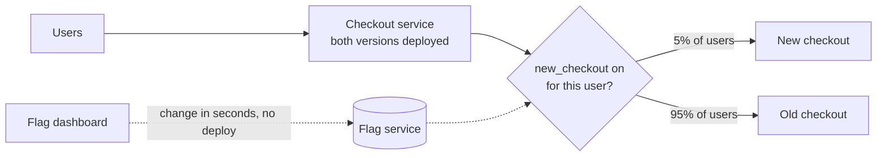

# Feature Flags

> A feature flag is an if statement you can flip without deploying. Ship the code turned off, turn it on for 1% of users, then everyone, and switch it off in seconds if it misbehaves.

## How it works

A flag is a named switch your code checks while it runs: "is `new_checkout` on for this user?" The answer lives in a flag service or a config table, not in the code, so changing it takes seconds and no deploy.

That splits two things people usually treat as one. Deploying puts code on servers. Releasing is when users actually see it. With flags, those can happen on different days, and a release becomes a setting instead of an event.

The common uses:

- **Kill switch.** Wrap a risky or expensive feature so you can turn it off during an incident without a rollback.
- **Gradual rollout.** Turn it on for 1%, then 10%, then 50%, watching errors at each step. Users are hashed into buckets, so the same person stays in or out between visits.
- **Targeting.** On for employees only, one city, or a list of beta customers.
- **Unfinished work.** Merge half built code to the main branch behind an off flag, instead of keeping a branch alive for weeks.

You can buy this from a vendor like LaunchDarkly, run an open source tool like Unleash, or start with a table in your own database.

The catch: flags pile up. Each one doubles the number of ways your code can run, and old flags nobody remembers turn into landmines. In 2012, Knight Capital reused an old flag that one server still wired to retired code, and the firm lost over $400 million in about 45 minutes. Give every flag an owner and an expiry date, and delete it once it's fully on.

## Example

A food delivery app rebuilds its checkout screen. The code ships on Monday with the flag off. Nothing changes for users.

On Tuesday, the flag turns on for employees. On Wednesday, 5% of users. Within an hour, the dashboard shows failed payments on the new checkout at 3%, against 0.4% on the old one, all on Android.

Someone flips the flag off. Within seconds, everyone is back on the old checkout. No deploy, no rollback, no war room. The team fixes the bug, ships it Thursday, and climbs back through 5%, 25%, and 100% the next week. Two weeks after that, a cleanup ticket deletes the flag and the old checkout code.

```python
if flags.is_enabled("new_checkout", user_id=user.id):
    return new_checkout(cart)
return old_checkout(cart)
```

## Picture it



Both checkouts are already deployed. The flag service decides who sees which one, and changing that split is a click on the dashboard, not a release.

## Related

[Canary Releases](canary-releases.md) · [Rollbacks](rollbacks.md) · [Graceful Degradation](../14-reliability/graceful-degradation.md) · [CI/CD](../19-build-and-infra/ci-cd.md) · [Blue Green Deployment](blue-green-deployment.md)

---

[← GitOps](../19-build-and-infra/gitops.md) · [All concepts](../../README.md) · [Rolling Deployments →](rolling-deployments.md)
