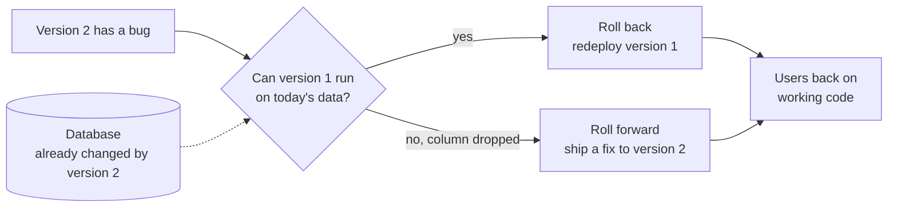

# Rollbacks

> A rollback puts the last good version back when a release goes wrong. Code is easy to roll back, but the data it already changed is not, and that's where rollbacks fail.

## How it works

When a release breaks something, the fastest fix is usually to stop running that release. A rollback puts the previous version back: `kubectl rollout undo`, flipping a blue green switch back, or turning off a feature flag. The goal is minutes, not hours. Fix the bug later, calmly, with users on working code.

Agree on the rule before the bad day: if errors spike after a deploy, roll back first and investigate second.

The hard part is data. Code doesn't remember anything, but the database does:

- **Schema changes.** If version 2 dropped a column, version 1 crashes looking for it.
- **New data.** If version 2 wrote rows in a new format for an hour, version 1 may not be able to read them.
- **Side effects.** Emails sent and cards charged stay sent and charged.

You can roll back code. You can't roll back what the code did.

The way out is to make every migration backward compatible. Add new columns first, ship code that writes both old and new, and drop the old column only in a later release, once you're sure you'll never go back.

Sometimes going back is worse than going forward. If the old version can't run on today's data, ship a quick fix instead. That's rolling forward. It's a fine choice, but a risky habit, because a rushed fix in the middle of an incident can make things worse.

Watch out: find out whether a release can be rolled back before you ship it, not during the incident. Ask in code review: if we roll this back an hour after deploy, what breaks?

## Example

A SaaS dashboard ships version 2 of its reports service. It splits the `name` column into `first_name` and `last_name`, with a migration that copies the data and drops `name`.

Thirty minutes after the deploy, PDF exports are broken. The team rolls back. Version 1 starts up, queries `name`, finds no such column, and every page returns 500. The rollback made things worse.

So they roll forward instead, fixing the export bug in version 2 and shipping it 25 minutes later. The next time, they split the change into three releases. First add the new columns and write both. Then switch reads. A week later, drop `name`. Any one of those steps can be rolled back alone.

## Picture it

The question that decides everything is whether the old code can still read the database. If it can, roll back. If a migration already changed things under it, rolling forward is the only fast way out.

## Related

[Database Migrations](../07-databases/database-migrations.md) · [Blue Green Deployment](blue-green-deployment.md) · [Feature Flags](feature-flags.md) · [Schema Versioning](../07-databases/schema-versioning.md) · [Production Incidents](../22-operations/production-incidents.md)

---

[← Canary Releases](canary-releases.md) · [All concepts](../../README.md) · [Backups →](../21-disaster-recovery/backups.md)
