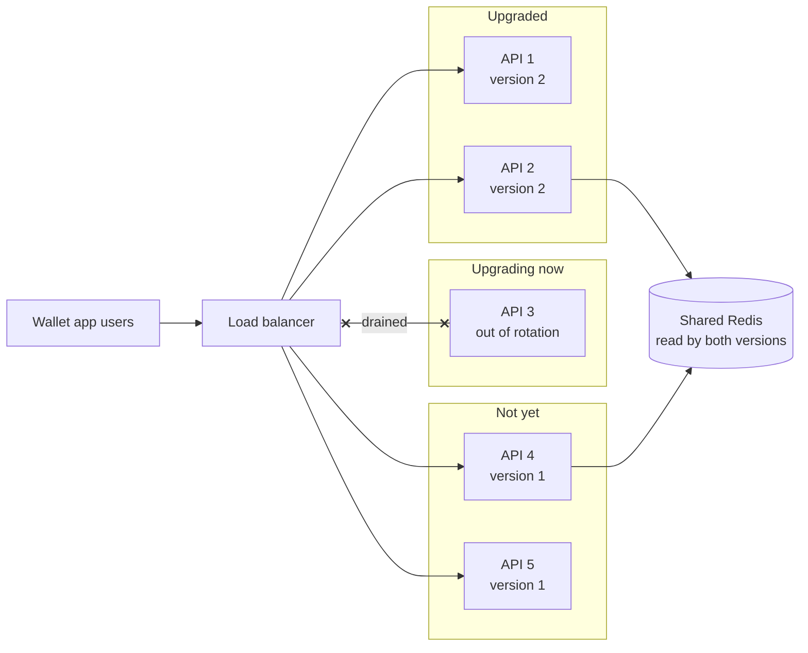

# Rolling Deployments

> A rolling deployment swaps old servers for new ones a few at a time, so the service never goes down. The price is that both versions run side by side for a while.

## How it works

Say you have 10 servers on version 1. A rolling deploy takes 2 of them out of rotation, upgrades them to version 2, waits for their health checks to pass, puts them back, and moves on to the next 2. Five rounds later, everything runs version 2, and you never had fewer than 8 servers serving.

The knobs:

- **Batch size.** How many to replace at once. Bigger is faster but leaves less spare capacity. Kubernetes calls this `maxUnavailable`.
- **Surge.** Start new servers before stopping old ones, so capacity never dips. Kubernetes calls this `maxSurge`. Both default to 25%.
- **Pause between batches.** Watch errors for a few minutes before continuing, and stop the rollout if they climb.

Rolling is the default in Kubernetes and most platforms because it needs little or no extra hardware. The downside: going back is just another rolling deploy in reverse, so a rollback takes as long as the rollout did.

The catch: for those 10 or 20 minutes, version 1 and version 2 serve traffic at the same time, often to the same user. One request hits a new server, the next hits an old one. Anything they share has to make sense to both: API responses, messages on a queue, rows in the database, data in a cache. If version 2 renames a field, version 1 breaks. Make changes in compatible steps. Add the new field, deploy, then remove the old one in a later release.

## Example

A wallet app runs 12 API servers and rolls out 3 at a time. Version 2 renames a field in the user's session, stored in a shared Redis, from `currency` to `currency_code`.

Halfway through the rollout, a user logs in on a version 2 server, which saves the session with the new name. Their next request lands on a version 1 server. It looks for `currency`, doesn't find it, and returns an error. For 15 minutes, about 4% of requests fail.

The fix is a two step change. Version 2 writes both fields and reads either one. A week later, once nothing old is running, version 3 drops `currency`. Each rollout is safe on its own, because every version running at the same time understands the data.

## Picture it

Mid rollout, the load balancer sends traffic to old and new servers at once. Both read the same Redis, so whatever version 2 writes there, version 1 must still understand.

## Related

[Blue Green Deployment](blue-green-deployment.md) · [Canary Releases](canary-releases.md) · [Database Migrations](../07-databases/database-migrations.md) · [API Versioning](../05-apis/api-versioning.md) · [Graceful Shutdown](../14-reliability/graceful-shutdown.md)

---

[← Feature Flags](feature-flags.md) · [All concepts](../../README.md) · [Blue Green Deployment →](blue-green-deployment.md)
