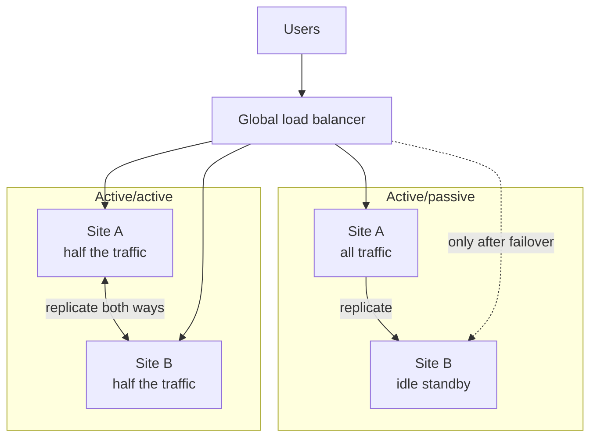

# Active/Active vs Active/Passive

> Active/passive keeps a standby site waiting until the main one fails, while active/active has every site serving real traffic all the time. Active/active recovers faster, but two sites taking writes can disagree about the data.

## How it works

In active/passive, one site takes all the traffic. The passive site keeps a copy of the data through replication and mostly sits idle. When the primary fails, you fail over to it. Writes only happen in one place, so data never conflicts. The downsides: you pay for a site that does nothing most days, failover takes minutes, and you never really know the standby works until you need it.

In active/active, two or more sites serve users at the same time. When one fails, the load balancer stops sending it traffic and the others absorb the load. There is no promotion step, and often no visible outage. Every site is tested by real users every second.

| | Active/passive | Active/active |
|---|---|---|
| Idle capacity | A whole standby site | Spare room on every site |
| Recovery | Minutes, needs a failover | Seconds, stop routing there |
| Data conflicts | None, one writer | Real, many writers |
| Complexity | Moderate | High |

The hard part of active/active is writes. If a user changes their name in Site A and again in Site B a second later, which one wins? You need a rule: last writer wins by timestamp, data types built to merge, or a home site per user that owns all their writes.

Watch out: active/active with every site running at 70 percent. When one of two sites dies, the survivor suddenly needs 140 percent and falls over too. Each site needs enough headroom to carry the full load alone.

## Example

A chat app starts active/passive: everything runs in Virginia, with a replica in Oregon. When Virginia has a bad afternoon, failover takes 20 minutes, and they discover the Oregon servers are two versions behind.

They move to active/active. Each user gets a home region, and only that region writes their messages, so two regions never write the same row. Both regions serve traffic all day and replicate to each other. When Oregon goes down for an hour, the load balancer sends Oregon's users to Virginia, which takes over as their home until Oregon is back. Virginia normally runs at 45 percent, so it has room for everyone.

## Picture it

On the left, Site B gets no traffic until Site A fails and someone flips the switch. On the right, both sites serve users all the time and replicate to each other, which is exactly why they can end up with two versions of the same row.

## Related

[Failover](failover.md) · [Multi Region Deployment](multi-region-deployment.md) · [Replication](../09-data-at-scale/replication.md) · [Eventual Consistency](../10-distributed-systems/eventual-consistency.md) · [High Availability](../02-scaling/high-availability.md)
