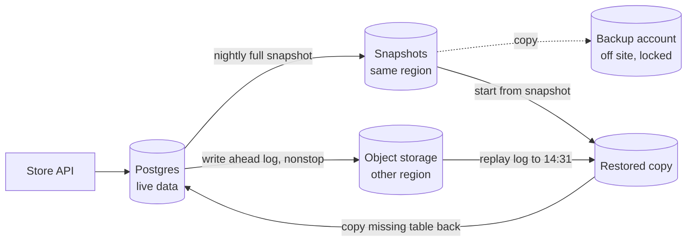

# Backups

> A backup is a copy of your data kept somewhere today's disaster cannot reach, so you can get it back after a bug, a breach, or a bad command. A backup you have never restored is a hope, not a backup.

## How it works

Replication is not a backup. If someone runs `DELETE FROM orders` by mistake, every replica deletes those rows within milliseconds. A backup is a copy from the past that today's mistakes cannot touch.

The classic rule is 3 2 1:

- **3 copies.** The live data plus two backups.
- **2 kinds of storage.** Say, database snapshots and files in object storage, so one failure cannot ruin both.
- **1 copy off site.** A different region, ideally a different cloud account, so losing a data center or a hacked admin login does not take everything.

There are two ways to copy. A full backup copies everything: big and slow, but simple to restore. An incremental backup copies only what changed since the last one: small and fast, but a restore needs the last full backup plus every incremental after it, in order.

Databases add point in time recovery. You keep a nightly snapshot plus a stream of every change since, like Postgres's write ahead log, and you can replay it to any moment. "Put the database back to 14:31, one minute before the bad migration."

The catch: nobody tests the restore. Backups fail quietly. The job has been writing empty files for months, the encryption key is gone, or the restore takes 30 hours when you can afford 2. Every month, restore into a fresh environment, check the data, and time it.

## Example

An online store keeps orders in Postgres, with nightly full snapshots and the write ahead log streamed to object storage in another region. At 14:32 a developer runs a migration meant for staging against production. It drops the `discount_codes` table.

With only the nightly snapshot, they would lose 14 hours of everything. Instead, they restore a separate copy of the database to 14:31, one minute before the drop, and copy just the missing table back into production. Rows lost: zero. Time taken: 50 minutes, which they knew in advance, because they rehearse this exact restore every month.

## Picture it

Three copies, two kinds of storage, one off site. The snapshot plus the stream of changes lets you rebuild the database at any minute, then copy back only what was lost.

## Related

[Disaster Recovery](disaster-recovery.md) · [RTO and RPO](rto-and-rpo.md) · [Write Ahead Log](../08-storage/write-ahead-log.md) · [Replication](../09-data-at-scale/replication.md) · [Object Storage](../08-storage/object-storage.md)

---

[← Rollbacks](../20-releases/rollbacks.md) · [All concepts](../../README.md) · [Disaster Recovery →](disaster-recovery.md)
