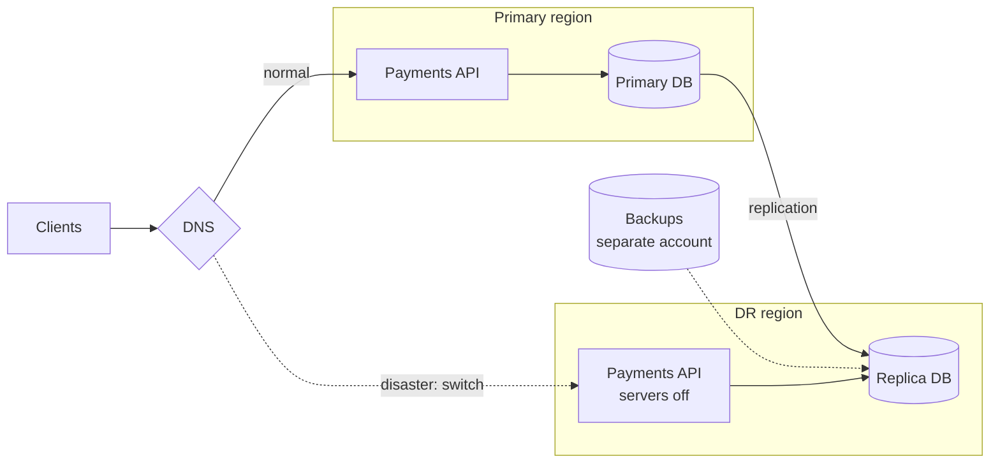

# Disaster Recovery

> Disaster recovery is your plan for when something big is gone: a whole region, your main database, or your cloud account. It decides how fast you come back and how much data you lose on the way.

## How it works

Everyday reliability work handles small failures: a server dies, a request times out. Disaster recovery, or DR, covers the big ones. A region goes dark. Ransomware encrypts your database. Someone deletes the production account. For each, the plan answers three questions: where do we run instead, where does the data come from, and who does what.

DR setups come in tiers, from cheap and slow to expensive and fast:

| Tier | What waits in the second region | Back in |
|---|---|---|
| Backup and restore | Backups only | Hours to days |
| Pilot light | A live copy of the data, servers off | Tens of minutes |
| Warm standby | A scaled down copy, fully running | Minutes |
| Hot standby | A full size copy, ready for traffic | Seconds to minutes |

Each step up costs more, and a hot standby can come close to doubling your bill. So pick the tier per system, based on what an hour of downtime really costs. Checkout might earn a hot standby. The internal reporting tool can wait for a restore.

The catch: a plan that has never been run does not work. Restore scripts point at servers that were renamed. The one person who knew the steps left. The backup region has no spare capacity, or the DNS change needs a login stored in the region that is down. Run a DR drill at least twice a year: actually fail over, time it, and write down everything that broke.

## Example

A payments API runs in one region, with its database replicated to a second region as a pilot light. The plan promises recovery in 30 minutes.

The first drill takes 4 hours. The failover script expects a database name that changed last year. The standby region's account is capped at 20 servers, and production needs 60. The TLS certificates for the API domain only exist in the primary region. And step 6 of the runbook says "ask Sam", who left in March.

They fix all four and drill again a month later: 35 minutes. The gap between 4 hours and 35 minutes is the whole value of a drill. Finding it on a calm Tuesday beats finding it during a real outage.

## Picture it

This is a pilot light. The data already flows to the DR region, but the servers there stay off until disaster strikes. Recovery means starting them, promoting the replica, and pointing DNS at the new region.

## Related

[Backups](backups.md) · [RTO and RPO](rto-and-rpo.md) · [Failover](failover.md) · [Multi Region Deployment](multi-region-deployment.md) · [Runbooks](../22-operations/runbooks.md)
