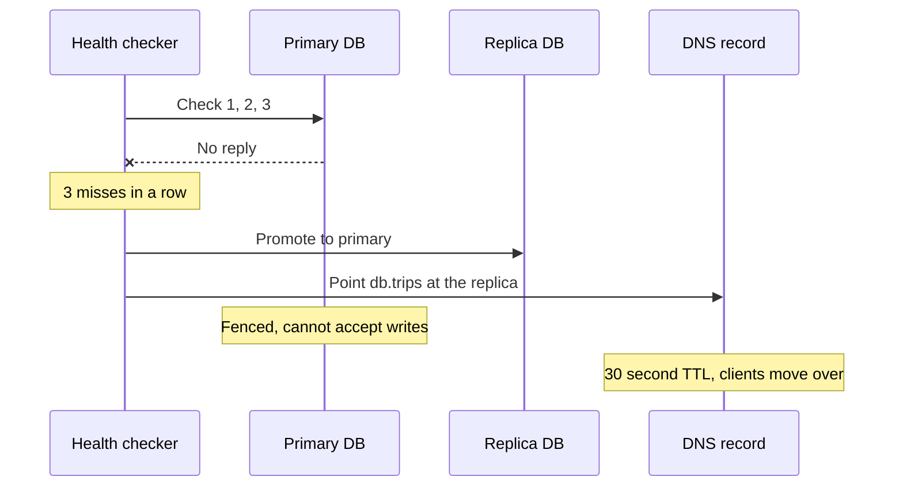

# Failover

> Failover is switching traffic from a broken primary to a standby that can take over. The hard parts are being sure the primary is really dead, and not bouncing back and forth when it is only slow.

## How it works

Every failover has three steps:

1. **Detect.** Health checks hit the primary every few seconds. After, say, 3 misses in a row, it is declared down.
2. **Promote.** The standby becomes the new primary. For a database, the replica starts accepting writes.
3. **Redirect.** Clients get pointed at the new primary, by moving a floating IP address, updating a load balancer, or changing a DNS record.

Automatic failover does all three in seconds with no human. Manual failover pages someone, who checks and then presses the button. Automatic is faster, but it trusts whatever the health check believes, and health checks can be wrong. Many teams automate failover inside one region and keep failover between regions manual.

DNS adds a delay you do not fully control. If a record has a time to live, or TTL, of 1 hour, clients may keep using the old address for up to an hour. Set a short TTL, like 60 seconds, on anything you might fail over, long before you need it.

The catch: false failovers and flapping. A network blip makes a healthy primary look dead, the standby gets promoted, and now two nodes both think they are primary and both accept writes. That is split brain. Or the old primary recovers, takes over, stutters, and fails over again every few minutes. Require several failed checks in a row, fence the old primary, meaning cut it off so it cannot accept writes, and never fail back automatically.

## Example

A ride sharing app runs its trips database as a primary with one replica in a second data center. Health checks run every 5 seconds, and 3 misses in a row trigger failover.

At 18:02 the primary's host loses power. By 18:02:15, three checks have failed. The replica is promoted, and the database's DNS name, with a 30 second TTL, now points at it. Drivers see errors for under a minute, then trips flow again. Writes from the last second before the crash, which had not reached the replica yet, are lost.

When the old primary boots back up, it does not grab the primary role again. It rejoins as a replica, and the team decides in daylight whether to switch back.

## Picture it

The checker waits for three misses, not one, so a single blip does nothing. Then it promotes the replica, moves DNS, and fences the old primary so it cannot wake up and accept writes on its own.

## Related

[Health Checks](../14-reliability/health-checks.md) · [Split Brain](../11-coordination/split-brain.md) · [DNS](../04-networking/dns.md) · [Active/Active vs Active/Passive](active-active-vs-active-passive.md) · [RTO and RPO](rto-and-rpo.md)

---

[← RTO and RPO](rto-and-rpo.md) · [All concepts](../../README.md) · [Active/Active vs Active/Passive →](active-active-vs-active-passive.md)
