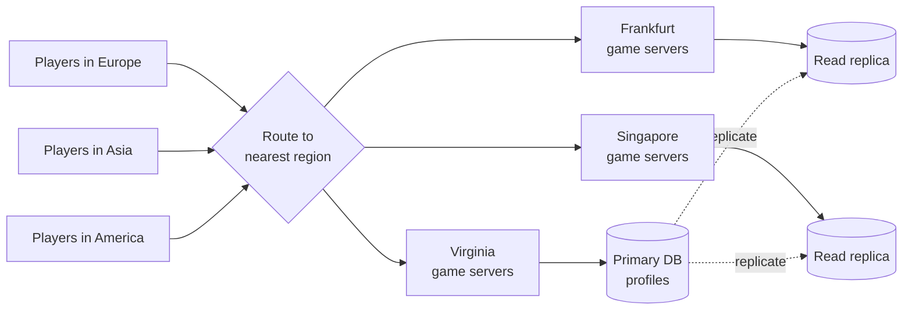

# Multi Region Deployment

> A multi region deployment runs your app in several parts of the world at once. Users get served from somewhere nearby, and losing one whole region does not take you offline.

## How it works

A cloud region is a group of data centers in one area, like Frankfurt or Tokyo. Running in one region is simple, but users far away pay for the distance. Light in fiber is fast, not instant: a round trip from Sydney to Virginia takes about 200 ms before your server does any work. A page that makes 5 calls in a row feels slow no matter how fast your code is.

Copying stateless app servers to more regions is the easy part. Data is the hard part, and there are three common shapes:

- **Single writer.** One region owns the database. The others serve reads from local replicas and send writes to the primary. Simple, but writes from far away stay slow.
- **Partitioned by user.** Each user's data lives in one home region. Fast for that user, and two regions never fight over the same row.
- **Multi writer.** Every region accepts writes and replicates to the others. Fastest, but now you have to resolve conflicts.

Data residency rules add a twist. The GDPR restricts moving personal data out of the EU, and some countries require certain data, like payment or health records, to stay inside their borders. Where someone's data lives becomes a legal decision, not just a latency one.

The catch: more regions multiply everything. Two regions roughly double your servers, and data copied between regions is billed per gigabyte. Many apps get most of the latency win from a CDN in front of a single region, and they should try that first.

## Example

A multiplayer game hosts everything in Virginia. Players in Europe see about 90 ms of lag and players in Singapore about 230 ms. In a shooter, 230 ms means you lose every close fight.

They add game servers in Frankfurt and Singapore. Matchmaking places each match in the region closest to its players, so a match in Singapore runs at around 30 ms for everyone in it. Player profiles and inventories stay in one primary database in Virginia, with read replicas in the other two regions, because a purchase can wait 200 ms but a headshot cannot. When Frankfurt has an outage, European players get matched in Virginia at higher lag instead of not playing at all.

## Picture it

Each player lands on the closest game servers, so the part that needs speed stays local. Profiles live in one primary database and are copied to replicas in the other regions, so reads are quick everywhere and only writes take the long trip.

## Related

[Active/Active vs Active/Passive](active-active-vs-active-passive.md) · [Disaster Recovery](disaster-recovery.md) · [Latency](../01-performance/latency.md) · [Replication](../09-data-at-scale/replication.md) · [CDN](../03-traffic/cdn.md)

---

[← Active/Active vs Active/Passive](active-active-vs-active-passive.md) · [All concepts](../../README.md) · [Production Incidents →](../22-operations/production-incidents.md)
