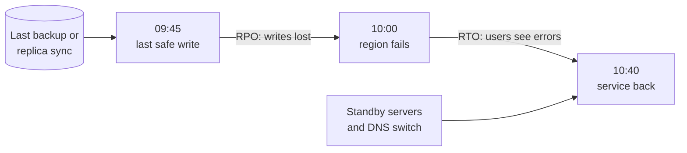

# RTO and RPO

> RTO is how long you can afford to be down, and RPO is how much recent data you can afford to lose. Those two numbers decide your whole disaster recovery setup, and its bill.

## How it works

Both are measured from the moment disaster strikes. One looks forward, one looks back:

- **RTO, recovery time objective.** The longest you can be down. An RTO of 1 hour means service must be back within 1 hour of the failure.
- **RPO, recovery point objective.** How old the data you recover is allowed to be. An RPO of 15 minutes means you can lose at most the last 15 minutes of writes.

RPO is set by how often data leaves the building. Nightly backups mean you can lose up to 24 hours. Streaming replication to another region gets that down to seconds. Synchronous replication, where a write is not confirmed until two sites have it, gets it to zero, but now every write waits for a round trip between sites.

RTO is set by how much is already running somewhere else. Restoring backups onto fresh servers takes hours. A warm standby that only needs DNS pointed at it takes minutes.

Pushing either number toward zero gets expensive fast. Going from 24 hours to 1 hour is cheap. Going from 1 minute to zero can mean paying for a second full copy of everything and slowing down every write. So set them per system, based on what an hour of downtime or a lost record actually costs you.

The catch: the numbers in the plan are not the numbers you have. Your real RTO is whatever your last drill measured. If you have never run one, you do not know your RTO.

## Example

A digital wallet company sets targets for two systems.

The ledger, which records every balance change, gets an RTO of 15 minutes and an RPO of zero. Losing a confirmed payment is not acceptable, so every write is copied synchronously to a second data center before the user sees "sent". That adds a few milliseconds to each write and means a second database running full time.

The marketing analytics warehouse gets an RTO of 3 days and an RPO of 24 hours. If it is lost, they restore last night's backup and rerun the import jobs. A nightly snapshot costs a few dollars a month.

Same company, same cloud, very different bills, because a lost payment and a lost chart are not the same problem.

## Picture it

Stand at the moment of the disaster. Looking back, the gap to your last safe copy is your RPO, set by how often data is copied. Looking forward, the gap until users are served again is your RTO, set by how ready your standby is.

## Related

[Disaster Recovery](disaster-recovery.md) · [Backups](backups.md) · [Failover](failover.md) · [Replication](../09-data-at-scale/replication.md) · [SLAs](../18-observability/slas.md)
