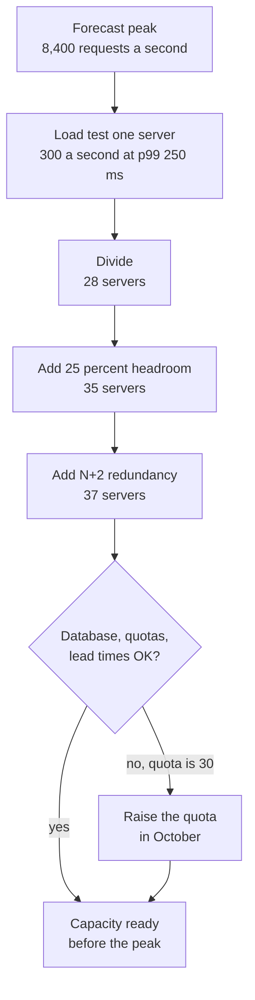

# Capacity Planning

> Capacity planning works out how much infrastructure you'll need for future peak traffic, and gets it in place before you need it. It turns a forecast and a load test into a server count with room to spare.

## How it works

Get it wrong one way and the site falls over at peak. Get it wrong the other way and you pay for idle servers all year. The steps:

1. **Forecast peak demand.** Start from last year's peak and add normal growth. Then add the events that don't follow the trend: a launch, a marketing push, a big sale.
2. **Measure one unit.** Load test a single instance and find the traffic it handles while still meeting your latency target. That's its real capacity, usually well below the point where it falls over.
3. **Divide, then add headroom.** Peak divided by capacity per instance is the bare minimum. Forecasts miss, and queues get slow long before a server is 100 percent busy, as [Kingman's Formula](../23-laws/kingmans-formula.md) shows. Leave a margin.
4. **Add redundancy.** N+1 means you can lose one instance and still serve the peak. Google's SRE book sizes a service at N+2: one instance down for an update while another fails.
5. **Check lead times.** Cloud quota increases, reserved capacity, and new database hardware can take days to months. Your forecast has to reach further ahead than the slowest of them.

Then compare the forecast with what actually happened, every month or quarter, and adjust.

The catch: planning the app servers and forgetting what's behind them. Autoscaling adds web servers in minutes. It doesn't raise your database's write limit, your connection limits, your cloud quota, or a payment provider's rate limit. Put every one of them through the same math.

## Example

An online store plans for Black Friday. Last year's peak was 5,000 requests a second. Traffic grew 40 percent this year, and a TV campaign might add another 20 percent. Forecast peak: about 8,400.

A load test shows one app server handles 300 requests a second with p99 under 250 ms. It survives 500, but latency triples past 350. So the minimum is 8,400 / 300 = 28 servers. Add 25 percent for a forecast that's off, and it's 35. Add 2 for N+2, and it's 37.

Now the parts behind the app. Checkout writes peak at 1,200 a second, and the orders database handled 2,000 in testing, so it's fine. But the cloud account's quota only allows 30 of those servers, and raising it takes a few days. The team files the request in October, not on Thanksgiving.

## Picture it

Each box is one step of arithmetic on top of the last. The final check is the one teams skip: the server count only helps if the database, the quota, and the calendar can keep up with it.

## Related

[Back of the Envelope Math](../01-performance/back-of-the-envelope-math.md) · [Kingman's Formula](../23-laws/kingmans-formula.md) · [Load Testing](load-testing.md) · [Autoscaling](../02-scaling/autoscaling.md) · [Cost Optimization](cost-optimization.md)

---

[← Load Testing](load-testing.md) · [All concepts](../../README.md) · [Postmortems →](postmortems.md)
