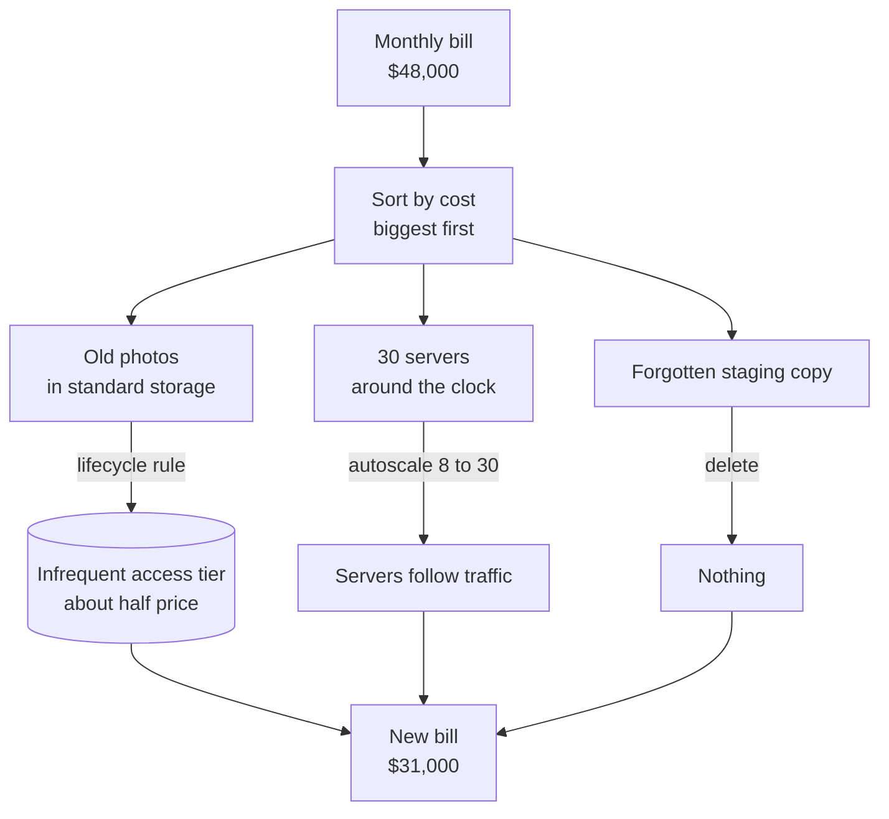

# Cost Optimization

> Cost optimization means paying for the cloud capacity you use, not the capacity you once guessed you might need. The usual waste is oversized servers, idle environments, and data nobody reads.

## How it works

Cloud bills grow quietly. Nobody decides to waste money. They pick a big server to be safe, spin up a test environment and forget it, or keep every log forever. The main levers:

- **Right sizing.** Look at real usage. A server averaging 8 percent CPU can usually drop two sizes, which is about a quarter of the price.
- **Autoscaling.** Run 4 servers at night and 20 at peak, instead of 20 around the clock.
- **Reserved and spot capacity.** Commit to 1 or 3 years of steady baseline usage for a big discount. Spot instances are spare capacity at up to 90 percent off, but the cloud can take them back with little warning, 2 minutes on AWS, so use them for work that can restart, like batch jobs and CI.
- **Storage tiers.** Move old data to cheaper storage classes, which charge more per read or take longer to fetch. Last year's logs do not need fast disks.
- **Data transfer.** Data leaving for the internet or crossing regions is billed per gigabyte, and on AWS and Google Cloud so is crossing zones. A chatty service talking across zones can cost more than the servers it runs on.
- **Turn it off.** Dev environments idle on nights and weekends, unattached disks, load balancers pointing at nothing.

Tag every resource with a team and a purpose, so the bill shows who is spending what.

The catch: optimizing the wrong thing. An engineer spends two weeks saving $200 a month while a forgotten $9,000 a month database cluster hums along in a test account. Sort the bill by cost, biggest line first, and start at the top.

## Example

A photo sharing app's cloud bill hits $48,000 a month. The team sorts it and finds three big lines.

First, 400 TB of original photos, all in standard object storage. Most photos are barely viewed after their first month, so a lifecycle rule moves anything older than 90 days to an infrequent access tier at roughly half the price. Second, 30 large thumbnail servers run around the clock, but traffic at 4 AM is a fifth of the peak, so autoscaling now ranges from 8 to 30. Third, a full staging copy of production, unused since a demo last spring, gets deleted.

The bill drops to about $31,000, and users notice nothing.

## Picture it

Start from the bill, not a hunch. Each of the three biggest lines gets a different fix: a cheaper storage tier, capacity that follows traffic, and deleting what nobody uses.

## Related

[Autoscaling](../02-scaling/autoscaling.md) · [Object Storage](../08-storage/object-storage.md) · [Vertical Scaling](../02-scaling/vertical-scaling.md) · [Back of the Envelope Math](../01-performance/back-of-the-envelope-math.md)

---

[← Postmortems](postmortems.md) · [All concepts](../../README.md) · [Fallacies of Distributed Computing →](../23-laws/fallacies-of-distributed-computing.md)
