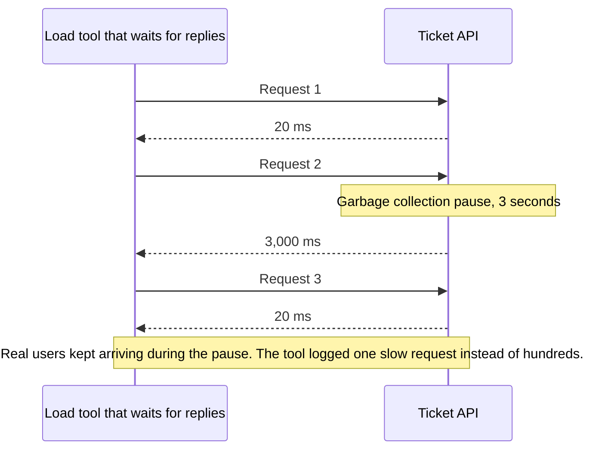

# Load Testing

> Load testing sends realistic fake traffic at your system to find its limits before real users do. Done right, it tells you how much traffic you can take and which part breaks first.

## How it works

A tool like k6, Gatling, JMeter, or Locust runs scripted user journeys from many machines at once. Meanwhile you watch latency percentiles, error rates, and the CPU, memory, and connection counts of everything behind the API.

Different questions need different shapes of traffic:

- **Load test.** Hold your expected peak for 30 minutes or so. Does p99 latency stay under target?
- **Stress test.** Push past the peak, step by step, until something gives. You learn the real limit and which part fails first.
- **Spike test.** Jump from normal to 10 times normal in a minute, the way a push notification or a ticket sale does.
- **Soak test.** Run normal load for 8 hours or more. Memory leaks, filling disks, and connection pools that slowly drain only show up with time.

Realism decides whether the numbers mean anything. Hammering one cached URL tests the cache. Script the real mix, say 70 percent browsing, 25 percent search, and 5 percent checkout, with production sized data, in an environment shaped like production.

Watch out for coordinated omission. Many tools give each virtual user a loop: send a request, wait for the reply, send the next. When the server stalls for 3 seconds, those users stall with it and send almost nothing, so the tool records a handful of slow requests instead of the thousands real users would have sent. Your p99 looks great because the tool politely stopped asking. The fix is an open model, which sends requests on a fixed schedule however slow the replies get, like k6's arrival rate executors. Tools like wrk2 also time each request from when it should have been sent.

## Example

A ticketing site expects 40,000 fans the minute a stadium tour goes on sale. The first load test loops 2,000 virtual users over the event page. p99 is 90 ms, and everyone relaxes. But that page is cached by the CDN, so the test mostly measured the CDN.

The second test scripts the real journey: event page, seat map, hold a seat, pay. It runs against a copy of the real seat inventory, with an open model that ramps from 600 to 3,000 requests a second over 20 minutes. Each journey makes 4 requests, so k6 starts 150 to 750 journeys a second:

```js
export const options = {
  scenarios: {
    onsale: {
      executor: 'ramping-arrival-rate',
      startRate: 150, timeUnit: '1s', // journeys, 4 requests each
      stages: [{ target: 750, duration: '20m' }],
      preAllocatedVUs: 500, maxVUs: 5000,
    },
  },
};
```

At 1,800 requests a second, the seat hold query starts waiting on row locks, and checkout p99 climbs to 6 seconds. The team finds it three weeks before the sale instead of during it.

## Picture it



The tool can't send request 3 until request 2 comes back, so it sits out the whole pause. Real users don't wait politely like that, which is why a closed loop test hides the worst latency.

## Related

[Capacity Planning](capacity-planning.md) · [P99 Latency](../01-performance/p99-latency.md) · [Throughput](../01-performance/throughput.md) · [Memory Leaks](../12-concurrency/memory-leaks.md) · [Chaos Engineering](../14-reliability/chaos-engineering.md)
