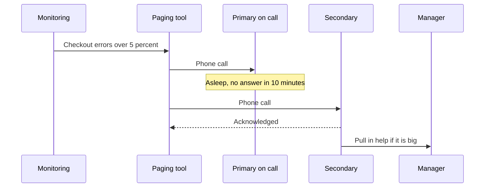

# On Call

> On call means one engineer at a time answers when production breaks, day or night. Done well, it is a fair rotation with rare pages, and done badly, it burns out your best people.

## How it works

A team shares a rotation, often one week per person. During your week you keep a laptop nearby, and a paging tool like PagerDuty calls your phone when an alert fires. If you do not acknowledge within, say, 10 minutes, it escalates to a secondary, then to a manager. Your job is not to fix everything alone. It is to stop the damage, using the runbook, and pull in the right people.

Keeping on call humane is an engineering problem, not a pep talk:

- **Page only for pain.** If it hurts users and needs a human now, page. A disk at 80 percent is a ticket for the morning.
- **Count the pages.** Google's SRE book suggests at most two incidents per 12 hour shift, because each one takes hours of follow up.
- **Give time back.** Pay for on call, or give a day off after a rough night.
- **Follow the sun.** Teams in different time zones hand off, so nobody gets paged in the middle of their night.
- **Fix the noise.** Quiet hours on shift go toward deleting or tuning the alerts that fired for nothing.

New people should shadow a shift before they carry the pager alone, and the escalation path should never end in "nobody answered".

The catch: alert fatigue. When half the pages are false alarms, people learn to snooze them, and one night they snooze a real one.

## Example

A SaaS dashboard team of 6 runs a weekly rotation. Last quarter the pager went off 140 times, about 11 times a week, mostly at night. Two engineers asked to move teams.

They pulled every alert from the last 90 days and sorted them. 70 percent came from one CPU alert that fired during the nightly report job and cleared on its own. Another 15 percent were warnings nobody had ever acted on. They deleted the first, turned the second into daytime tickets, and kept paging only for errors and slowness that users could feel. Next quarter: 18 pages, and two weeks with none at all.

## Picture it

The page climbs the chain until a human says "I have it". Nobody has to stay awake to guarantee coverage, because the next person is always one timeout away.

## Related

[Production Incidents](production-incidents.md) · [Runbooks](runbooks.md) · [Postmortems](postmortems.md) · [Alerts](../18-observability/alerts.md) · [SLOs](../18-observability/slos.md)
