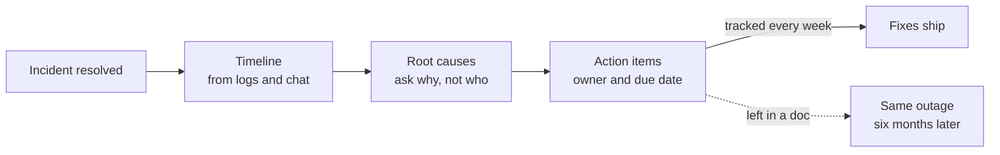

# Postmortems

> A postmortem is a write up after an incident that explains what happened, why, and what will change so it does not happen again. It blames systems, not people, because blame teaches people to hide what they know.

## How it works

Write one after every serious incident, within a few days, while memories are fresh. A good postmortem has four parts:

- **Summary.** What broke, for how long, and how many users it hit, in three sentences.
- **Timeline.** Timestamps from the first bad signal to full recovery: when it started, when someone noticed, when it was fixed. The gaps are where the lessons hide.
- **Root causes.** Usually plural. Keep asking "why" until you reach things you can change. "The engineer ran the wrong command" is not a root cause. "The tool let one command delete production with no confirmation" is.
- **Action items.** Specific changes, each with one owner and a due date.

Blameless does not mean nobody did anything. It means you assume people made reasonable choices with the information and tools they had at the time. Punish someone for an honest mistake, and the next person will quietly fix their own mistake and tell nobody, and you lose the lesson.

Share postmortems widely. Other teams get to learn from your outage for free.

The catch: action items that never happen. The document gets written, everyone nods, and the tickets rot in the backlog until the same outage comes back six months later. Keep the list short, because three real fixes beat fifteen wishes. Track them in the same place as feature work, and review open items every week.

## Example

A ticketing site goes down for 47 minutes during a big concert presale. The timeline shows the database ran out of connections at 10:00:30, thirty seconds after sales opened. The alert fired at 10:02, but it went to an email list, so nobody saw it until customers complained on social media at 10:15.

Root causes: a new feature opened a fresh database connection for every request instead of reusing a pool, the load test simulated 1,000 users when the sale drew 40,000, and the connection alert did not page anyone.

Action items, each with an owner: add connection pooling, load test at twice the expected peak before big sales, and send database alerts to the pager. All three ship within two weeks, and the next presale runs clean.

## Picture it

The work flows from facts to causes to fixes. The fork at the end is the whole game: action items that get tracked ship, and ones that live only in the document come back as the next incident.

## Related

[Production Incidents](production-incidents.md) · [Runbooks](runbooks.md) · [On Call](on-call.md) · [Error Budgets](../18-observability/error-budgets.md) · [Connection Pooling](../07-databases/connection-pooling.md)
