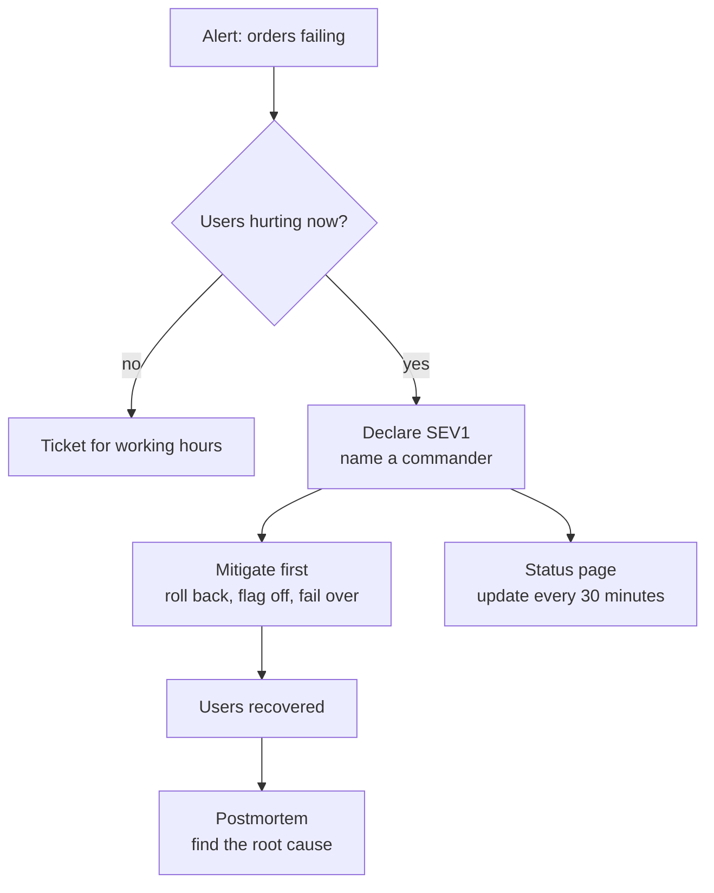

# Production Incidents

> A production incident is anything that hurts users right now and needs a coordinated response. The playbook is short: name a leader, stop the bleeding first, and keep users informed while you fix it.

## How it works

Not every bug is an incident. An incident is when users are hurting now: checkout fails, data looks wrong, the site is down. Teams sort incidents by severity, so everyone knows how loud to be:

| Level | Meaning | Response |
|---|---|---|
| SEV1 | Core feature down for many users | Page everyone needed, any hour |
| SEV2 | Major feature broken or very slow | Page on call, work it now |
| SEV3 | Minor issue, a workaround exists | Fix during working hours |

Once an incident is declared, one person becomes the incident commander. They do not debug. They coordinate: who is looking at what, which decision comes next, when the next update goes out. Without a commander, five engineers try five fixes at once and nobody knows which one worked.

The first goal is mitigation, not the root cause. Roll back the last deploy, turn off the feature flag, fail over, add servers. Get users working again, then figure out why. A rollback in 5 minutes beats a perfect fix in 2 hours.

Talk to users early and on a schedule. Post on the status page within minutes, even if all you can say is "we are investigating failed checkouts". Then update every 30 minutes, even when nothing changed.

The catch: waiting too long to declare. People spend 40 minutes quietly poking at a problem, hoping it is small, while users suffer. Declaring is cheap. If you are wondering whether it is an incident, it is.

## Example

Friday, 19:05, peak dinner time. A food delivery app's order success rate drops from 99 percent to 60 percent. The engineer on call declares a SEV1 and takes the commander role. She sends one engineer to check recent deploys and another to check the payment provider, and asks the support lead to post on the status page.

At 19:12 they spot a deploy from 18:58 that changed how promo codes are checked. Nobody has proven it is the cause. They roll it back anyway, because it is the newest change and rolling back is fast. By 19:16 orders recover. The status page says "resolved" at 19:30, and the real digging happens Monday, in the postmortem.

## Picture it

Fixing and communicating run side by side, both run by the commander. The root cause comes at the very end, after users are fine, not in the middle while they are still failing.

## Related

[On Call](on-call.md) · [Runbooks](runbooks.md) · [Postmortems](postmortems.md) · [Rollbacks](../20-releases/rollbacks.md) · [Feature Flags](../20-releases/feature-flags.md)
