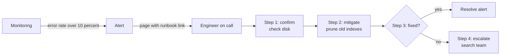

# Runbooks

> A runbook is a step by step guide for handling one specific alert or task. It is written so a tired person at 3 AM, who has never seen this problem before, can follow it without thinking hard.



## How it works

Every alert should link to a runbook. The person paged clicks the link and gets steps, not a blank terminal. A good runbook answers four questions, in order:

1. **What does this alert mean?** One or two plain sentences, plus what users are seeing.
2. **How do I confirm it?** The dashboard link or the exact command to run, and what normal and broken output look like.
3. **How do I stop the damage?** The safest fix first, as commands you can copy and paste.
4. **Who do I call if that fails?** A team or a rotation, never a single person who might be on vacation.

Write for the worst case reader: half asleep, new to the team, stressed. Give exact commands, not "restart the service". Put the warning before the dangerous step, not after it. Leave out the history of why the system works this way, and link to it instead.

The best runbooks shrink over time. If a step is the same every time, script it. If the whole runbook is one script, let the alert run it automatically and page a human only when it fails.

The catch: runbooks rot. Hostnames change, a dashboard moves, a command gets a new flag, and nobody notices until someone follows the old steps in the middle of an outage. Give every runbook an owner and a "last tested" date, and fix it in the postmortem every time it was wrong.

## Example

A news site's search breaks on election night. The alert says "Search error rate over 10 percent". The engineer on call joined 3 weeks ago and has never touched search.

She clicks the runbook link in the alert. Step 1 says to check whether the search cluster's disk is full, with the exact command. It is, at 95 percent. Step 2 is the fix:

```
Step 2. Free disk space
  Safe: only deletes indexes older than 30 days.
  Never delete the index named articles-today.
  $ ./scripts/search-prune --older-than 30d
  Expect: disk below 70 percent within 2 minutes.
```

Step 3 shows how to confirm search is healthy again. Search is back in 8 minutes, and nobody on the search team had to wake up.

## Picture it



The alert carries the link, so the engineer goes straight from the page to the steps. Confirm, mitigate, check, and escalate only when the steps did not work.

## Related

[On Call](on-call.md) · [Alerts](../18-observability/alerts.md) · [Production Incidents](production-incidents.md) · [Postmortems](postmortems.md)

---

[← On Call](on-call.md) · [All concepts](../../README.md) · [Load Testing →](load-testing.md)
