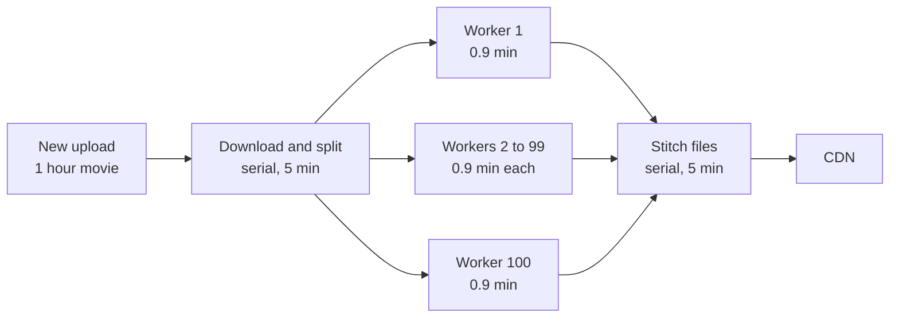

# Amdahl's Law

> Amdahl's Law says the part of a job that can't run in parallel caps your speedup. If 10% of the work must happen in order, a thousand machines still can't make it more than 10 times faster.

## How it works

Split any job into two parts: the bit you can spread across workers, and the bit that has to happen one step at a time. Adding workers shrinks the first part. The second part doesn't budge.

The formula is `speedup = 1 / ((1 - p) + p / n)`. Here `p` is the fraction of the work that can run in parallel, `n` is the number of workers, and `1 - p` is the serial part left over. As `n` grows, `p / n` heads to zero, and the speedup tops out at `1 / (1 - p)`.

| Parallel share | 10 workers | 100 workers | Ceiling |
|---|---|---|---|
| 50% | 1.8x | 2.0x | 2x |
| 90% | 5.3x | 9.2x | 10x |
| 99% | 9.2x | 50x | 100x |

Gene Amdahl, a computer architect at IBM, made the argument in a 1967 conference paper. The paper has no equations at all. The formula came later, built from his reasoning.

In real systems the serial part hides in plain sight: one database every worker writes to, one lock, one coordinator that merges results, one step that waits for the slowest worker.

The catch: teams keep adding machines long after the curve has gone flat. Past that point, every new worker costs full price and buys almost nothing. Shrink the serial part instead. Cutting it from 10% to 5% doubles the ceiling, which no amount of hardware can do.

## Example

A video streaming site transcodes every upload into 5 quality levels. On one machine, a 1 hour movie takes 100 minutes: 10 minutes to download the source and stitch the final files, and 90 minutes of encoding that splits cleanly into chunks.

That's `p = 0.9`. With 10 workers, the job takes 10 + 9 = 19 minutes, about 5.3 times faster. With 100 workers, it takes 10 + 0.9 = 10.9 minutes, about 9.2 times faster. The team paid for 90 more machines to save 8 minutes, and no number of machines will ever get them under 10.

So they attack the serial part. Workers start encoding chunks while the download is still running, and each quality level gets stitched in parallel. The serial part drops to 3 minutes, and the same 100 workers now finish in under 4 minutes.

## Picture it

Only the middle fans out. Add as many workers as you like and every video still waits on the two serial boxes, so 10 minutes is the floor.

## Related

[Universal Scalability Law](universal-scalability-law.md) · [Horizontal Scaling](../02-scaling/horizontal-scaling.md) · [Throughput](../01-performance/throughput.md) · [Capacity Planning](../22-operations/capacity-planning.md) · [Pareto Principle](pareto-principle.md)

---

[← FLP Impossibility](flp-impossibility.md) · [All concepts](../../README.md) · [Universal Scalability Law →](universal-scalability-law.md)
