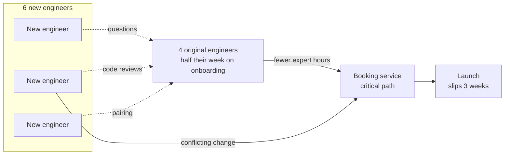

# Brooks's Law

> Throw more engineers at a late software project and it usually ships even later. Newcomers need weeks to become useful, and every extra person adds conversations, so the team slows down before it speeds up.

## How it works

Fred Brooks wrote it in The Mythical Man Month (1975), drawing on his time managing IBM's OS/360 software project. His line: "Adding manpower to a late software project makes it later."

Two forces do the damage:

- **Ramp up time.** A new engineer needs weeks to learn the code, the deploy process, and why the billing table has three status columns. During those weeks they also pull hours from the people who already know, who are your fastest people.
- **Communication paths.** Every pair of people is a possible conversation. With n people that's `n(n-1)/2` pairs: 4 people have 6, 10 have 45, 20 have 190. More meetings, more merge conflicts, more "wait, who changed that?"

On top of that, some work doesn't split. Brooks's example was a baby, which takes nine months however many people you assign. A database migration that has to run in order, or one tricky concurrency bug, is the same.

Brooks himself called the law an outrageous oversimplification. People added early, or put on work that splits cleanly, can help. People added late, onto the critical path (the chain of work that sets the ship date), nearly always hurt.

The catch: treating engineer weeks as a currency you can swap around. "12 weeks of work, 6 people, done in 2" is the math that gets projects into trouble. A late project is better rescued by cutting scope, moving the date, or giving newcomers separate work that doesn't need the core team's attention.

## Example

A ride sharing app has 4 engineers building scheduled rides. Launch is 6 weeks out and they are about 4 weeks behind. The director moves 6 engineers over from other teams.

In week one, the original 4 spend half their time onboarding, reviewing code, and explaining why the pricing service caches surge prices for 30 seconds. In week two, two newcomers change the same booking code and break dispatch in staging. Communication paths went from 6 to 45, and the daily standup now runs 40 minutes. The launch slips another 3 weeks.

What finally works: cut recurring rides from the first release, and give 4 of the newcomers a separate job, the admin tool support agents need, which talks to one API and needs no tour of the dispatch code.

## Picture it

Every newcomer pulls time from the same 4 people who know the booking service. The critical path gets fewer expert hours, not more, while the number of people who need to stay in sync jumps from 4 to 10.

## Related

[Conway's Law](conways-law.md) · [Amdahl's Law](amdahls-law.md) · [Universal Scalability Law](universal-scalability-law.md) · [Gall's Law](galls-law.md) · [Coupling and Cohesion](../24-principles/coupling-and-cohesion.md)
