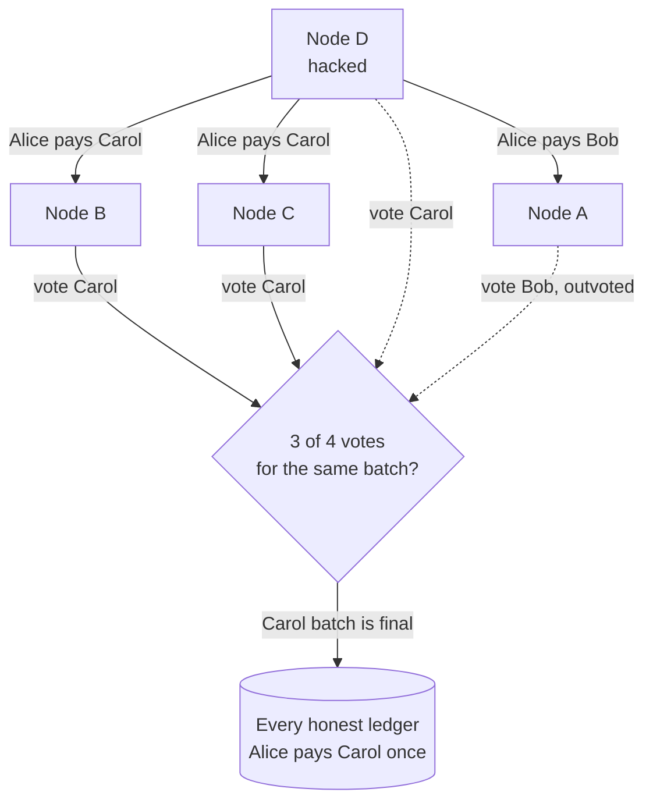

# Byzantine Generals Problem

> The Byzantine Generals Problem asks how honest servers can agree when some of them lie. To survive f liars you need at least 3f + 1 nodes, and the consensus inside most databases doesn't even try.

## How it works

Most failure plans assume a broken server goes quiet: it crashes, stops replying, and the rest carry on. A Byzantine failure is worse. The server keeps talking, but what it says is wrong, because of a bug, a corrupted disk, or an attacker. It can even tell different peers different things.

Leslie Lamport, Robert Shostak and Marshall Pease named the problem in a 1982 paper, with generals plotting by messenger and some of them traitors. Their result: with plain spoken messages, where a traitor can lie about what others told it, the loyal generals can only agree if more than two thirds of them are loyal. That's where 3f + 1 comes from. To survive f liars, you need at least 3f + 1 nodes, and a decision needs matching votes from 2f + 1 of them.

| Faults to survive | Crashes only (Raft) | Liars too |
|---|---|---|
| 1 | 3 nodes | 4 nodes |
| 2 | 5 nodes | 7 nodes |

Why isn't 3 enough for one liar? The liar tells one peer "commit" and the other "abort". When the two honest nodes compare notes, each sees a conflict and can't tell which of the other two is lying. Unforgeable signatures change the math in the paper's model, but practical protocols like PBFT, a well known design from 1999, still run 3f + 1 replicas.

The catch: Raft and classic Paxos only handle crashes. They trust every message, so one buggy node can write garbage into the shared log. Inside one company you usually defend with checksums, authentication, and input validation instead. Full Byzantine protocols are for nodes run by parties that don't trust each other. Blockchain engines like CometBFT, for example, need votes from validators holding more than two thirds of the voting power to commit a block.

## Example

Four banks share a ledger to settle payments between them. Each runs one node, and none fully trusts the others, so they use a Byzantine fault tolerant protocol: a batch is final only when 3 of the 4 nodes vote for the exact same batch.

Bank D's node gets hacked and tries a double spend. Alice has $100. D tells Bank A's node "Alice pays Bob $100" and tells B and C "Alice pays Carol $100".

If every node believed whatever it was told, A and B would now hold different ledgers, and Alice's $100 would be spent twice. Under the 3 of 4 rule, the Carol batch gets votes from B, C, and D and becomes final. The Bob batch has only A's vote, so A drops it and takes the final batch. Every honest ledger agrees.

Now try it with 3 banks and a 2 of 3 rule. D votes for both versions, each one gets 2 votes, and the ledgers split. That's the 3f + 1 rule in action.

## Picture it

D tells A a different story than it tells B and C. The Carol batch collects 3 of 4 votes and becomes final, A's lone vote for Bob loses, and every honest node ends up with the same ledger.

## Related

[Consensus](../11-coordination/consensus.md) · [Quorum](../10-distributed-systems/quorum.md) · [Two Generals Problem](two-generals-problem.md) · [FLP Impossibility](flp-impossibility.md) · [Zero Trust](../16-identity-and-encryption/zero-trust.md)
