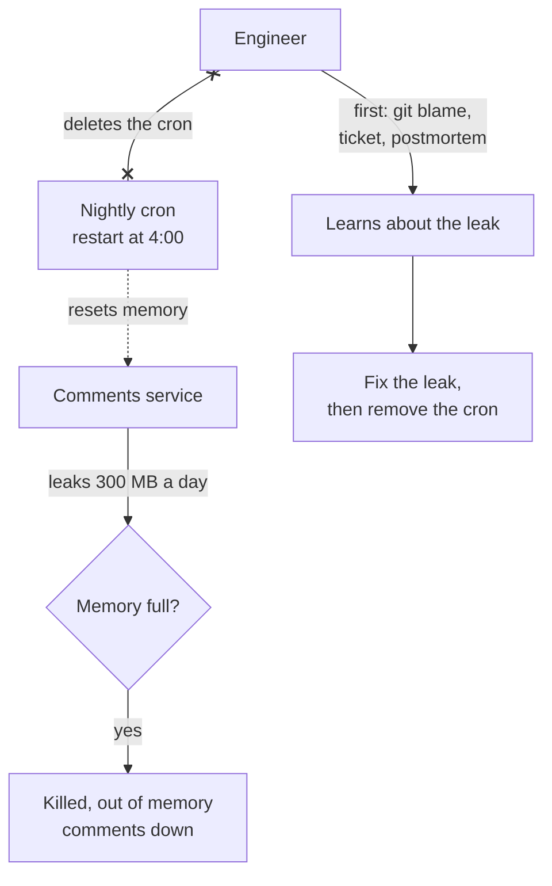

# Chesterton's Fence

> Before you remove something that looks pointless, find out why it was put there. The odd retry, sleep, or cron job is often the scar from an old outage, and deleting it brings the outage back.

## How it works

G. K. Chesterton told it as a parable in his 1929 book The Thing. A reformer finds a fence across a road, can't see what it's for, and wants it torn down. A wiser reformer refuses: if you don't know why it's there, go and find out first, then we can talk about removing it.

Production systems are full of fences. Each one was somebody's fix for a real problem, often written in a hurry during an incident, with no comment. Years later it just looks weird:

- **The odd retry.** One retry on a single error code from a partner API, because their load balancer drops the first request on an idle connection.
- **The sleep.** A 500 ms pause before reading back a write, because reads go to a replica that lags behind the primary.
- **The cron job.** A nightly restart of a worker, because it leaks memory and nobody ever found the leak.
- **The magic number.** A batch size of 37, because 38 pushes the payload past a vendor's size limit.

The rule is not "never remove anything". Most fences can go, and old cruft has a real cost. The rule is to do the research first: `git blame`, the commit message, the linked ticket, the postmortem, or a message to whoever wrote it. That usually takes 10 minutes, which is cheap next to an outage.

Watch out for the second half of the lesson. Once you know why the fence exists, fix the underlying problem, then remove the fence. And whenever you add a fence, leave a comment with the reason and a ticket link, so the next person doesn't have to dig.

## Example

A news site has a cron job that restarts the comments service every night at 4:00. A new engineer tidying up finds no comment and no ticket, notices that each restart drops a few requests, and deletes it.

Five days later, during a breaking news spike, the comments servers start crashing with out of memory errors. Each server leaks about 300 MB a day, and the nightly restart had been quietly resetting the clock for two years.

A search through old chat history turns up the story: a leak in an image resizing library, never fixed, papered over with a restart. The safe order would have been: find out why the cron exists, upgrade the leaking library, watch memory stay flat for a week, then delete the cron with a commit message that explains all of it.

## Picture it

The cron job looked like noise, but it was the only thing keeping memory under the limit. The safe path runs from the engineer through the research: ask why first, fix the leak, and only then take the fence down.

## Related

[Cron Jobs](../13-messaging/cron-jobs.md) · [Memory Leaks](../12-concurrency/memory-leaks.md) · [Postmortems](../22-operations/postmortems.md) · [Runbooks](../22-operations/runbooks.md) · [Gall's Law](galls-law.md)

---

[← Law of Leaky Abstractions](law-of-leaky-abstractions.md) · [All concepts](../../README.md) · [End to End Principle →](../24-principles/end-to-end-principle.md)
