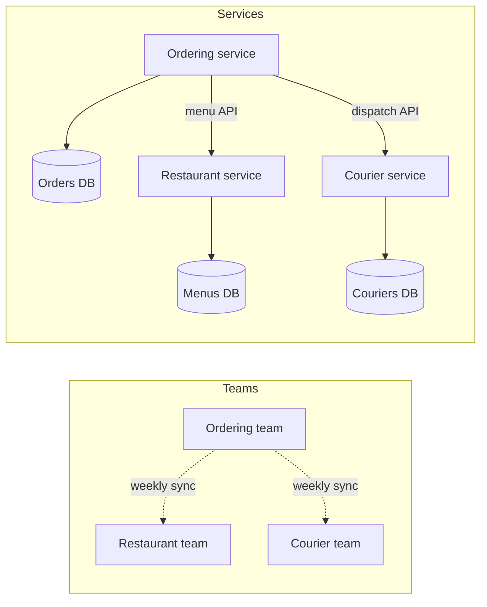

# Conway's Law

> Systems end up shaped like the teams that build them. Two teams that rarely talk build two parts with a thin, awkward seam between them, so if you want a certain architecture, arrange the teams first.

## How it works

Melvin Conway made the case in a 1968 Datamation article, after Harvard Business Review turned it down for lack of proof. Fred Brooks later named it Conway's Law in The Mythical Man Month.

The mechanism is plain. To build anything big, you split the work between people. Wherever two pieces have to fit together, the people building them have to talk. So the interfaces in your system land where the conversations are, and the hard walls land where they aren't. Conway's own example: a contract shop put 5 people on a COBOL compiler and 3 on an ALGOL compiler. The COBOL one came out with 5 phases, the ALGOL one with 3.

What it looks like in a company:

- **Teams per layer.** A frontend team, a backend team, and a database team build three layers, and every feature needs a meeting of all three.
- **Teams per business area.** An orders team and a payments team build an orders service and a payments service with an API between them.
- **Teams in two offices.** A team split across time zones tends to build two halves that meet at a narrow, heavily negotiated seam.

The inverse Conway maneuver turns this into a tool: pick the architecture you want, shape the teams to match, and let the law do the work. Jonny LeRoy and Matt Simons coined the term in 2010.

Watch out: splitting a monolith into microservices without touching the org chart. If one team still owns all 12 services, they will keep changing and deploying them together. That's a distributed monolith: all the network calls of microservices, none of the independence.

## Example

A food delivery app has a web team, a mobile team, and a backend team. The backend team owns one big API and one Postgres database. A feature like "schedule an order for later" needs all three: backend adds fields, web and mobile wait, then everyone ships together. Each feature takes about 6 weeks, mostly waiting. The API has also grown separate endpoints for web and for mobile, because those are the two teams the backend team talks to.

They reorganize by business area: ordering, restaurants, and couriers. Each team gets its own web, mobile, and backend engineers and owns its service and its data. Over the next year the code follows. An ordering service, a restaurant service, and a courier service appear, with small APIs exactly where the teams coordinate. The next ordering feature ships from one team in 2 weeks, because the conversation that used to cross three teams now happens at one standup.

## Picture it

Compare the two boxes. The ordering team talks to the other two teams, and the ordering service calls the other two services. The APIs show up exactly where the conversations are, and each team keeps its own database.

## Related

[Monolith vs Microservices](../15-architecture/monolith-vs-microservices.md) · [Domain Driven Design](../15-architecture/domain-driven-design.md) · [Coupling and Cohesion](../24-principles/coupling-and-cohesion.md) · [Brooks's Law](brooks-law.md) · [Strangler Fig](../15-architecture/strangler-fig.md)
