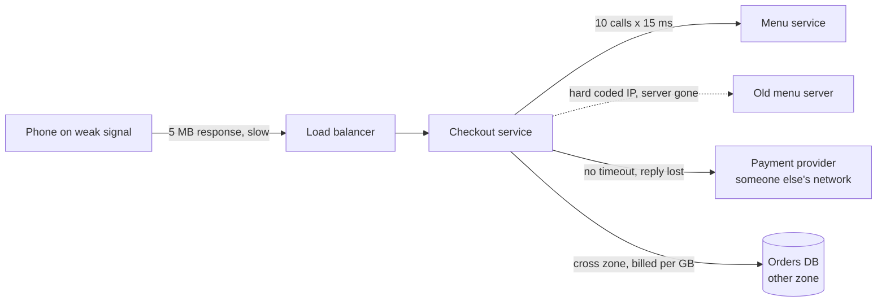

# Fallacies of Distributed Computing

> Eight things everyone assumes about the network the first time they build a distributed system. All eight are false, and each one breeds its own family of production bugs.

## How it works

On your laptop, a call to another service takes 0.1 ms and never fails. In production, the same call crosses cables, switches, and other people's config. The fallacies list what stops being true when that happens.

The list grew up at Sun Microsystems in the 1990s. The first four were already Sun folklore, L Peter Deutsch wrote them down with more, and the eighth is usually credited to James Gosling, though Deutsch remembers adding the last four himself.

| Fallacy | The bug it causes |
|---|---|
| The network is reliable | A call with no timeout hangs forever when a reply gets lost |
| Latency is zero | A page makes 50 calls in a row and takes a full second |
| Bandwidth is infinite | An API sends a 5 MB response to a phone on one bar of signal |
| The network is secure | Internal services talk plain HTTP with no auth, so one hacked box reads everything |
| Topology doesn't change | A hard coded IP address breaks when a server gets replaced |
| There is one administrator | Another team changes a firewall rule and your calls start failing |
| Transport cost is zero | Chatty traffic between zones shows up as a huge cloud bill |
| The network is homogeneous | A JavaScript client rounds 64 bit IDs, so it fetches the wrong record |

That last one is real: Twitter, now X, tells API users to read IDs from the `id_str` string field, because JavaScript can't hold numbers past 53 bits exactly.

Watch out: none of these bugs show up in local testing, because your laptop makes all eight assumptions true. Inject delay, packet loss, and dead dependencies in staging before production does it for you.

## Example

A food delivery app's checkout calls the menu service once per cart item to get prices, at a hard coded IP, with no timeout. In development, everything runs on one laptop: 10 calls at 0.1 ms each, 1 ms total.

In production, the menu service sits in another zone, and each call takes about 15 ms. A 10 item cart now spends 150 ms on price lookups alone. Then, at 7 pm on a Friday, a deploy replaces the menu server and its IP changes. Checkout keeps dialing the old address, and each connection attempt hangs for about two minutes before Linux gives up. Orders pile up.

Three fixes, three fallacies: one batch call for the whole cart (latency is not zero), a 300 ms timeout with one retry (the network is not reliable), and service discovery instead of an IP (topology changes).

## Picture it

Every arrow is a network hop, and each label is one fallacy turning into a bug. On a laptop none of these hops really exist, which is why the bugs wait for production.

## Related

[Network Partitions](../10-distributed-systems/network-partitions.md) · [Timeouts](../14-reliability/timeouts.md) · [Latency](../01-performance/latency.md) · [Service Discovery](../15-architecture/service-discovery.md) · [Chaos Engineering](../14-reliability/chaos-engineering.md)

---

[← Cost Optimization](../22-operations/cost-optimization.md) · [All concepts](../../README.md) · [PACELC →](pacelc.md)
