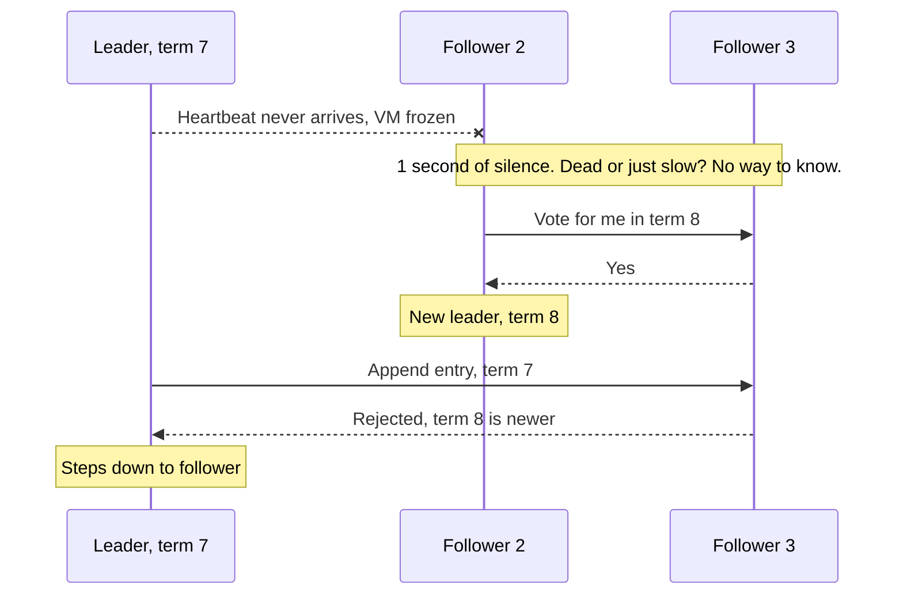

# FLP Impossibility

> FLP proves that when messages can take any amount of time, a group of servers can't be guaranteed to finish agreeing if even one of them might crash. Real systems get around it by trusting timeouts.

## How it works

Michael Fischer, Nancy Lynch and Michael Paterson proved it in a paper published in 1985. The setup is a fully asynchronous network: every message arrives eventually, but there's no limit on how long it takes, and no clocks to measure it. Then they allow just one server to crash, silently, at the worst moment.

The trouble is that a crashed server and a slow one look exactly the same. Wait for it, and if it's dead, you wait forever. Move on without it, and if it was only slow, its late vote can change the outcome. The proof shows that a deterministic algorithm, one that always reacts the same way to the same messages, can always be kept from ever deciding by an endless series of badly timed delays.

What FLP does not say:

- **Not "consensus is impossible".** It rules out a guarantee that every possible run finishes. Most runs finish fine.
- **Not "you must accept wrong answers".** Raft and Paxos never let two servers decide differently. FLP only takes away the promise that they'll always decide.
- **Not "real networks are that bad".** Real delays are usually bounded, just not always.

So real systems assume a little timing. In the Raft paper, a follower that hears nothing from the leader for a random 150 to 300 ms assumes it's dead and starts an election. Raft keeps its answers correct no matter the timing, and lets only availability depend on the clock.

The catch: a timeout is a guess, not proof of death. The old leader may only be paused, and it can wake up still thinking it's in charge. That's why Raft stamps every message with a term number, and followers reject anything from an older term.

## Example

A chat app keeps its shard map in a 3 node etcd cluster with etcd's defaults: the leader sends a heartbeat every 100 ms, and a follower that hears nothing for 1,000 ms starts an election.

One afternoon the leader's VM freezes for 3 seconds. The followers can't tell frozen from dead. After a second or so of silence, follower 2 asks for votes, wins follower 3's, and becomes leader for term 8. Writes resume a second or two after the freeze began. When the old leader wakes up and sends an update stamped term 7, the followers refuse it, and it steps down.

Then someone "tunes" the heartbeat to 30 ms and the election timeout to 150 ms to fail over faster. Cross zone round trips sometimes spike past that, so the cluster now holds elections several times an hour, and writes stall each time. Too short means false alarms, too long means slow recovery. FLP says no setting is perfect.

## Picture it

The followers act on a guess: silence means dead. When the guess turns out wrong and the old leader wakes up, the term number stops it from causing damage. Timing decides when things move, never whether the answer is right.

## Related

[Consensus](../11-coordination/consensus.md) · [Leader Election](../11-coordination/leader-election.md) · [Timeouts](../14-reliability/timeouts.md) · [Heartbeats](../10-distributed-systems/heartbeats.md) · [Split Brain](../11-coordination/split-brain.md)

---

[← Byzantine Generals Problem](byzantine-generals-problem.md) · [All concepts](../../README.md) · [Amdahl's Law →](amdahls-law.md)
