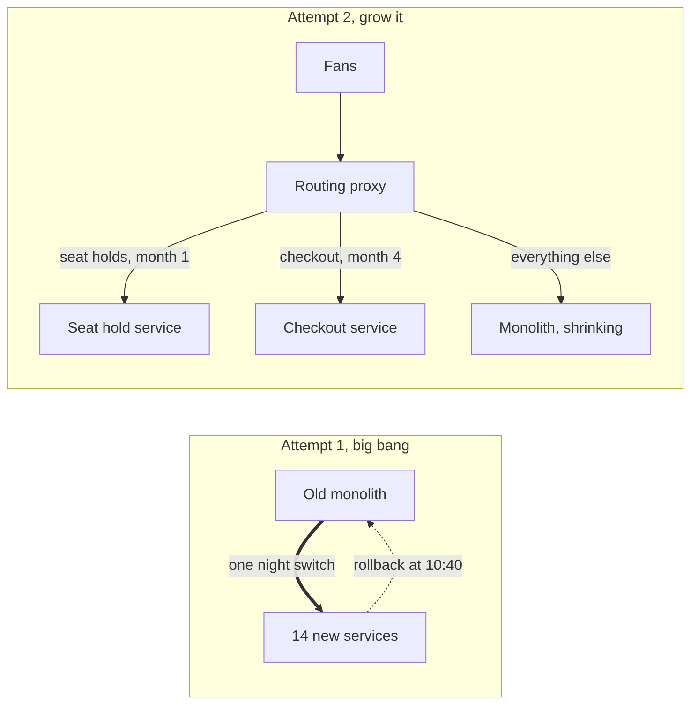

# Gall's Law

> Every complex system that works grew out of a simple system that worked. Design the complex version from scratch and it won't work, and no amount of patching will fix it.

## How it works

John Gall, a pediatrician, wrote it in General Systemantics (1975), a dry, funny book about why systems misbehave, later reissued as Systemantics.

Why it holds: a working system is full of answers to questions nobody knew to ask. Which retries are safe. Which query gets slow at 10 million rows. What users actually click. A simple system running in production collects those answers one at a time, and each fix lands on something that already works. A big design on paper has none of them. It meets every surprise on the same day, and when 14 things fail together you can't tell which one to fix first.

Where it bites real systems:

- **Big bang rewrites.** Replacing a working system all at once throws away years of hidden fixes. The new one has to rediscover each of them in production.
- **Big bang launches.** Turning on 20 new services on the same day gives you 20 new ways to fail and no known good state to fall back to.
- **Platform first projects.** Building the event bus, the service mesh, and the plugin system before a single user flow works end to end.

The alternative is boring and it works. Ship the thinnest path that does the real job, run it with real traffic, then add one piece at a time. Each step starts from something that works.

The catch: Gall's Law does not say "never build complex systems". It says you can't skip the route there. And when a complex system is failing in many ways at once, more patches rarely help. Gall's advice was to go back to a simple version that works and grow it again.

## Example

A ticketing site sells concert tickets from a 10 year old monolith. The team spends 18 months building its replacement: 14 services, a new event bus, a new database. The plan is to switch everything over in one night, right before a big stadium show goes on sale.

At 10:00 the queue service and the seat map disagree about which seats are held. Payments time out because the new fraud check calls three other services. Nobody can tell which of the 14 parts is wrong, so at 10:40 they switch back to the monolith, after 6,000 fans saw errors.

Round two follows Gall. A proxy sends only seat holds to a new service, for one small venue, while the monolith does everything else. It runs for a month. Then checkout moves. A year later the monolith is gone, and no part ever had to work for the first time on a big day.

## Picture it

Attempt 1 asks 14 untested parts to work together on their first night. Attempt 2 moves one slice at a time behind a proxy, so every step starts from a system that already works.

## Related

[Strangler Fig](../15-architecture/strangler-fig.md) · [KISS](../24-principles/kiss.md) · [YAGNI](../24-principles/yagni.md) · [Canary Releases](../20-releases/canary-releases.md) · [Chesterton's Fence](chestertons-fence.md)

---

[← Hyrum's Law](hyrums-law.md) · [All concepts](../../README.md) · [Postel's Law →](postels-law.md)
