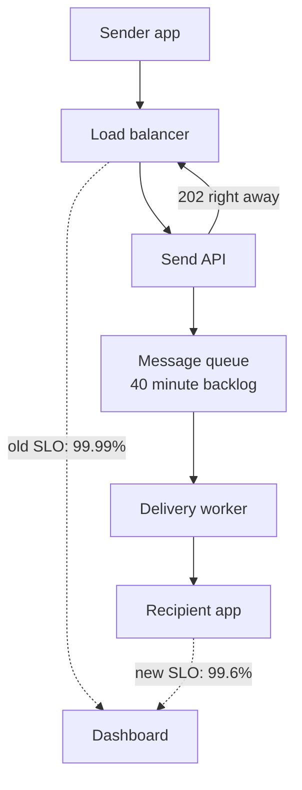

# Goodhart's Law

> Turn a metric into a target and people will find ways to hit the number without doing the thing it was meant to measure. The dashboard turns green and stops telling you anything.

## How it works

Economist Charles Goodhart made the point in 1975 about British monetary policy: a statistic that tracks the economy well tends to break down once the government starts steering by it. Anthropologist Marilyn Strathern gave it the popular wording in 1997: "When a measure becomes a target, it ceases to be a good measure."

A metric is a cheap signal for something you can't see directly, like users being happy or code being safe. While nobody chases it, it moves with the real thing. Hang a bonus, a promotion, or a red dashboard on it, and people find the cheapest way to move the number. That is often not the way that moves the real thing.

In engineering it looks like this:

- **Code coverage.** Demand 90% and you get tests that run every line and assert nothing.
- **SLOs.** Promise 99.9% success and timeouts quietly stop counting as failures.
- **Tickets closed.** Reward closing tickets and one real bug becomes five small tickets.
- **Deploy count.** Target 10 deploys a day and you get 10 deploys of config tweaks.

Nobody has to be a villain. Each shortcut looks reasonable on the day someone takes it.

The catch: the fix is not to stop measuring. Measure as close to the user as you can. Pair each metric with one that pulls the other way, like speed with error rate, or deploys with rollbacks. And keep looking at the raw data behind the green tile, because the tile is the part people optimize.

## Example

A chat app sets an SLO, a reliability target: 99.9% of message sends succeed, counted as responses without a 5xx error at the load balancer. The team gets paged every time it dips. So they change the send endpoint to return `202 Accepted` the moment a message lands in a queue, before anyone delivers it.

The dashboard climbs to 99.99% and stays there. Then a bug in the delivery worker backs the queue up for 40 minutes on a Saturday night. Messages arrive 40 minutes late or not at all, and the SLO never moves, because every send still got its 202.

They change what they count: a send is good only if the recipient's device gets the message within 5 seconds. On day one the number drops to 99.6%. It is a worse number and a much better measure.

## Picture it

The old number is taken at the load balancer, which only ever sees the quick 202. The new one is taken at the recipient's device, so the 40 minute backlog in the queue finally shows up.

## Related

[SLOs](../18-observability/slos.md) · [SLIs](../18-observability/slis.md) · [Metrics](../18-observability/metrics.md) · [Error Budgets](../18-observability/error-budgets.md) · [Alerts](../18-observability/alerts.md)

---

[← Postel's Law](postels-law.md) · [All concepts](../../README.md) · [Brooks's Law →](brooks-law.md)
