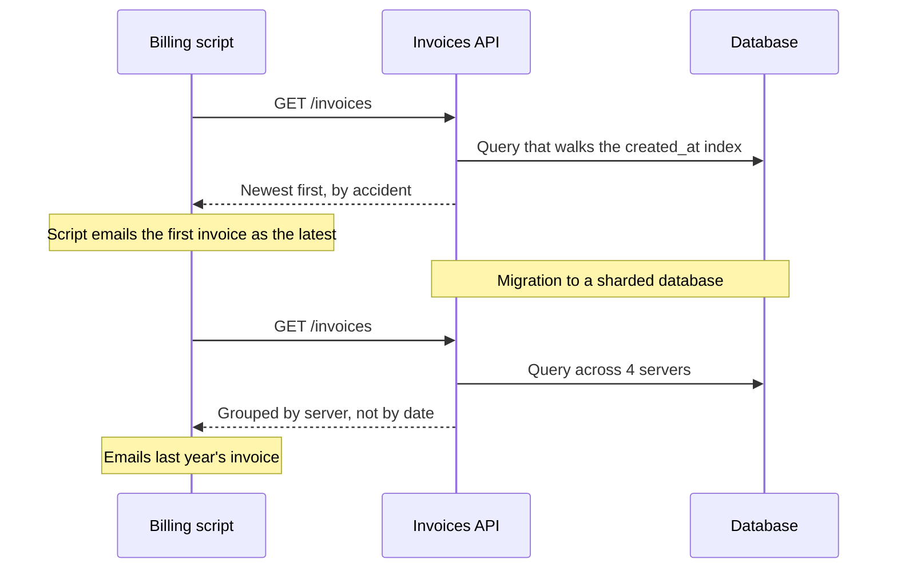

# Hyrum's Law

> Once enough people use your API, every behavior they can see becomes part of the contract, documented or not. Someone depends on your error text, your response order, and your timing.

## How it works

It is named after Hyrum Wright, who kept running into it while making large code changes across Google. His colleague Titus Winters gave it the name, and it appears in the 2020 book Software Engineering at Google. The short version: with enough users, "all observable behaviors of your system will be depended on by somebody."

Your docs are the contract you meant. The behavior is the contract people actually code against. With 10 users the gap rarely matters. With 10,000, someone leans on every quirk:

- **Error message text.** A client matches "card declined: insufficient funds" with a regex. Fix a typo and their retry logic breaks.
- **Response order.** The docs say nothing about order, but results come back sorted because of an index. Someone treats the first item as the newest.
- **Timing.** An endpoint always answers in 50 ms, so a client sets a 100 ms timeout. Your new feature adds 80 ms and their app starts failing.
- **Undocumented limits.** A page size of 100 that nobody wrote down, or a field that has never once been null.

So any change can break someone, even a bug fix. Careful API owners fight back by making unpromised behavior visibly unpredictable. Go made map iteration order unpredictable in Go 1 so that code relying on it would break early, in tests, instead of years later.

The catch: "it was never in the docs" does not save you. If your biggest customer breaks, you have an outage too. Before you change something observable, measure who relies on it, then ship the change behind a new version or a flag, with notice.

## Example

A SaaS dashboard has a public `GET /invoices` endpoint. The docs never promise an order, but invoices come back newest first, because the old query happened to walk an index on `created_at`.

The team moves invoices to a sharded database, which splits the rows across 4 servers. Results now come back grouped by server. Every test passes and the docs are still technically correct. Overnight, 40 customer billing scripts break, because they read `invoices[0]` as the latest invoice and email it out. Two of them send last year's invoice to 3,000 people.

The fix: put newest first back and document it as the default, add an explicit `sort` parameter, and shuffle any order you do not promise in the sandbox environment. New integrations then trip over the randomness during testing, when it costs nothing, instead of in production a year later.

## Picture it

The docs did not change between the two calls. Only an accident of the old query went away, and the script had quietly made that accident part of its contract.

## Related

[API Versioning](../05-apis/api-versioning.md) · [Semantic Versioning](../19-build-and-infra/semantic-versioning.md) · [Postel's Law](postels-law.md) · [Pagination](../05-apis/pagination.md) · [Law of Leaky Abstractions](law-of-leaky-abstractions.md)

---

[← Conway's Law](conways-law.md) · [All concepts](../../README.md) · [Gall's Law →](galls-law.md)
