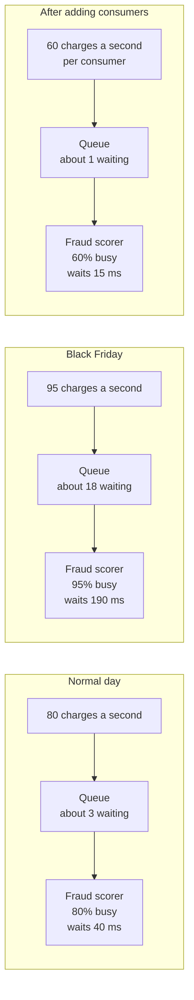

# Kingman's Formula

> Kingman's formula estimates how long work waits in a queue. Waiting grows like utilization over one minus utilization, so a worker that's 95% busy makes jobs wait about five times longer than one at 80%.

## How it works

John Kingman, a British mathematician, published this approximation in 1961. It covers one worker pulling jobs from one queue, and it's most accurate when that worker is busy, which is exactly when you care. It multiplies three plain parts:

`wait ≈ (ρ / (1 - ρ)) × ((ca² + cs²) / 2) × τ`

- **Utilization, ρ (rho).** The fraction of time the worker is busy. This is the part that explodes.
- **Variability, ca and cs.** How uneven the gaps between arrivals and the job durations are, measured as spread divided by average. 0 means clockwork, 1 is typical random traffic, and bursty traffic goes higher.
- **Service time, τ (tau).** How long one job takes on average.

Look at the first part. At 50% busy, `ρ / (1 - ρ)` is 1. At 80% it's 4, at 90% it's 9, and at 99% it's 99. The last few points of utilization cost more than all the others combined. That's why a queue looks fine for months and then falls off a cliff during one busy hour.

This is why teams plan headroom and aim for something like 70% busy at peak, not 95%. Idle capacity isn't waste, it's what keeps waits flat when traffic jumps. And because variability multiplies everything, evening out job sizes, like splitting giant jobs into small ones, cuts waiting just as adding capacity does. Pools of several workers bend later than a single one, but they still bend.

The catch: averages hide the spike. A worker at 70% over an hour can sit at 98% for the five minutes that matter. Watch utilization over short windows.

## Example

A payments API scores every charge for fraud. Each Kafka partition has one consumer that takes about 10 ms per event, so it can handle 100 events a second. Arrivals and job times are both random enough that the variability part is about 1.

On a normal day, 80 events a second land on a partition: 80% busy, so each event waits 4 × 10 ms = 40 ms. On Black Friday, traffic rises to 95 a second. That's only 19% more traffic, but the wait becomes 19 × 10 = 190 ms, and by Little's Law about 18 events sit in line at any moment. At 99 a second, the wait nears a full second.

The team adds partitions and consumers until each one runs about 60% busy at the expected peak. The wait drops to 1.5 × 10 = 15 ms.

## Picture it

Same worker, same 10 ms per event. Going from 80% to 95% busy multiplies the wait by almost five and the line by almost six. Spreading the load until each consumer is 60% busy brings the wait down to 15 ms.

## Related

[Little's Law](../01-performance/littles-law.md) · [Message Queues](../13-messaging/message-queues.md) · [Capacity Planning](../22-operations/capacity-planning.md) · [Tail Latency](../01-performance/tail-latency.md) · [Backpressure](../13-messaging/backpressure.md)

---

[← Universal Scalability Law](universal-scalability-law.md) · [All concepts](../../README.md) · [Zipf's Law →](zipfs-law.md)
