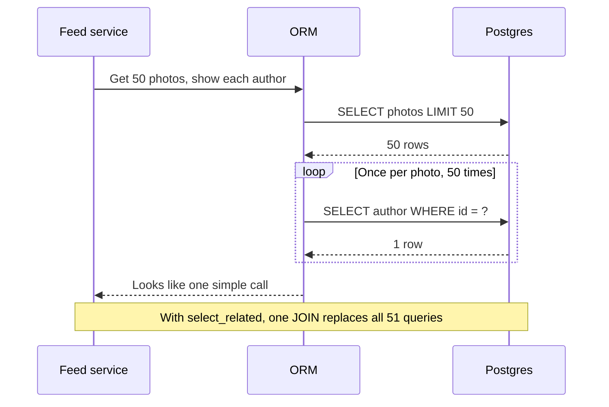

# Law of Leaky Abstractions

> Every useful abstraction hides messy details, and sooner or later those details leak through. When they do, you need to understand the layer underneath, the one the abstraction promised you could ignore.

## How it works

Joel Spolsky named it in a 2002 essay on his blog, Joel on Software. An abstraction is a simple interface over messy machinery: TCP over a network that drops packets, an ORM (a library that turns rows into objects) over SQL, a file API over a network drive. It works most of the time, and that's the trap. The day it doesn't, the machinery shows through.

Spolsky's main example is TCP. It promises every byte arrives, in order, on top of IP, which promises nothing. TCP hides lost packets by quietly sending them again. But it can't hide a cut cable, and on a lossy mobile link it can't hide the cost. A request that takes 80 ms on good WiFi takes 3 seconds after a few resends. The abstraction stayed correct and got slow.

Common leaks in real systems:

- **ORMs.** `post.author` looks like a field. It's a database query, and in a loop over 50 posts it's 50 queries.
- **Remote calls.** A call to another service looks like a function call, until it hangs for 30 seconds.
- **Caches.** A cache looks like fast storage, until a restart empties it and every request hits the database at once.

None of this means abstractions are bad. They let you build fast. In Spolsky's words, they "save us time working, but they don't save us time learning."

The catch: treating the abstraction as the whole truth. Use the ORM, but know the SQL it writes and turn on query logging. Use TCP, but set timeouts, because the network will eventually do something TCP can't hide.

## Example

A photo sharing app shows a feed of 50 photos, each with the author's name. The code looks harmless:

```python
photos = Photo.objects.order_by("-created_at")[:50]
for photo in photos:
    print(photo.author.name)
```

In development, with 5 photos and a database on the same laptop, the page loads in 20 ms. In production it sends 51 queries: 1 for the photos and 1 for each author, each a 2 ms round trip to the database. That's about 100 ms of pure waiting, and under load the connection pool runs dry.

The ORM didn't lie. `photo.author` really is the author. It just hid that each access is a trip to the database. Adding `select_related("author")` turns 51 queries into 1 join, but you only find that fix if you know what the ORM does underneath.

## Picture it



The feed service thinks it made one call. Under the abstraction, the ORM sent 51 queries, one per author. The fix lives in the exact layer the abstraction was supposed to hide.

## Related

[N+1 Queries](../07-databases/n-plus-one-queries.md) · [TCP vs UDP](../04-networking/tcp-vs-udp.md) · [Fallacies of Distributed Computing](fallacies-of-distributed-computing.md) · [Timeouts](../14-reliability/timeouts.md) · [Hyrum's Law](hyrums-law.md)
