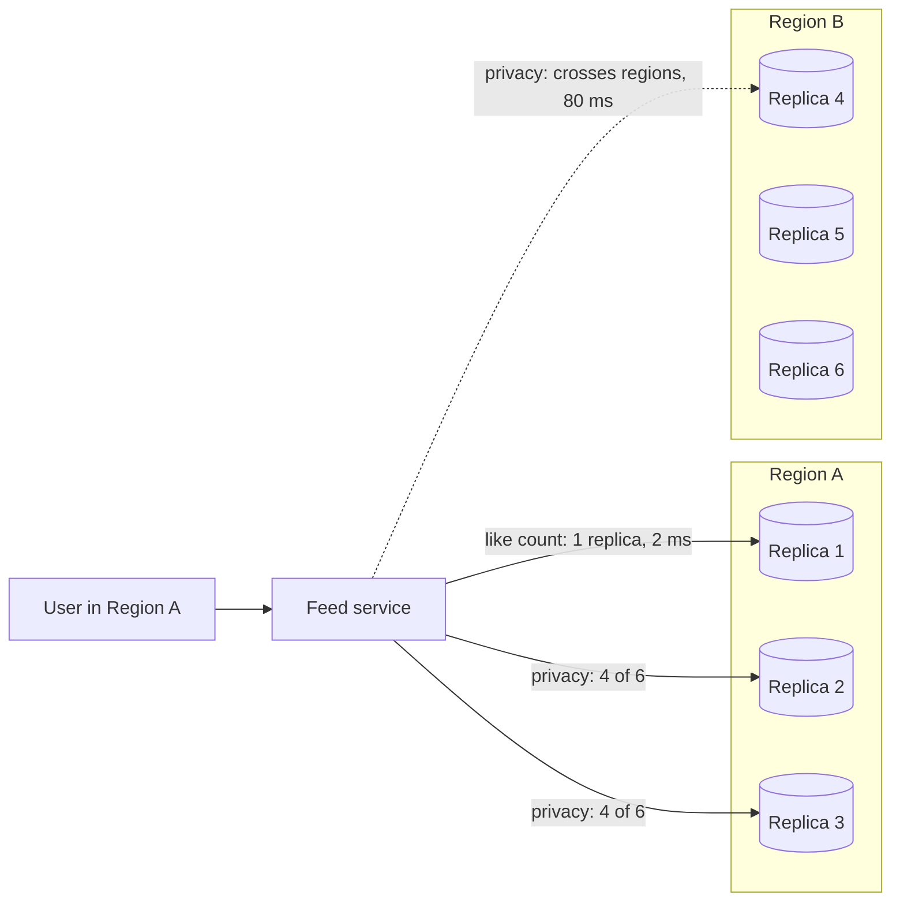

# PACELC

> PACELC extends CAP to normal days: during a Partition, pick Availability or Consistency, Else pick Latency or Consistency. That second choice hits every single request, not just the rare outage.

## How it works

CAP only talks about the rare moment the network splits. Daniel Abadi, then a database professor at Yale, pointed out in a 2010 blog post and a 2012 paper that the bigger tradeoff happens when nothing is broken. To keep copies of the data (replicas) in sync, a write has to reach the other replicas before you call it done, or a read has to check more than one. Waiting costs latency. Not waiting means a read might see old data.

So every replicated database gets a two part label:

- **PA or PC.** During a partition, does it keep answering (A) or refuse until it's safe (C)?
- **EL or EC.** Else, in normal operation, does it answer fast from one replica (L) or wait for others to agree (C)?

Abadi's paper puts the default setups of Dynamo, Cassandra, and Riak in PA/EL: fast and available, sometimes stale. VoltDB, Megastore, and HBase are PC/EC: they keep consistency and pay for it in latency and availability. Yahoo's PNUTS is the odd one out, PC/EL.

The catch: these are defaults, not fixed traits. Abadi's own paper notes that Dynamo, Cassandra, and Riak let you change those defaults to buy more consistency with more latency. Cassandra lets you pick a consistency level per query, so one cluster can run like counts as PA/EL and account settings much closer to PC/EC. Label the operation, not the product.

## Example

A social feed runs Cassandra in two regions, with 3 replicas in each. Like counts are read and written at `LOCAL_ONE`: one nearby replica answers in about 2 ms. Sometimes a refresh shows 1,203 likes instead of 1,204. Nobody cares.

Privacy settings are different. A user flips a post to "friends only", and a stale read could keep showing it to strangers. So those reads and writes use `QUORUM`: 4 of the 6 replicas must answer, which always includes at least one in the other region. Each call now takes about 80 ms instead of 2. In return, any two groups of 4 out of 6 overlap, so a read always reaches a replica that has the latest saved setting.

When the link between regions drops, the PA or PC half of the label kicks in. Like counts keep working on each side. Privacy changes fail until the link is back, because each side can reach only 3 replicas.

## Picture it

The like count takes one short hop to a nearby replica: fast, maybe stale. The privacy setting has to wait for a replica in the other region. Same database, two different PACELC choices.

## Related

[CAP Theorem](../10-distributed-systems/cap-theorem.md) · [Quorum](../10-distributed-systems/quorum.md) · [Eventual Consistency](../10-distributed-systems/eventual-consistency.md) · [Strong Consistency](../10-distributed-systems/strong-consistency.md) · [Replication](../09-data-at-scale/replication.md)

---

[← Fallacies of Distributed Computing](fallacies-of-distributed-computing.md) · [All concepts](../../README.md) · [Two Generals Problem →](two-generals-problem.md)
