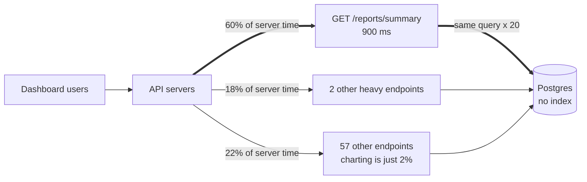

# Pareto Principle

> The Pareto principle is the rough pattern that most of an effect comes from a few causes, often quoted as 80/20. In systems work it means profile first, because a handful of endpoints or queries usually cause most of the slowness.

## How it works

List the causes of almost anything, like slow requests, errors, cloud spend, or support tickets, and sort them by impact. The top few usually account for most of the total. 80/20 is the catchy version. Real splits might be 90/10 or 70/30, and the two numbers don't need to add up to 100, because they measure different things: 20% of the queries, 80% of the database time.

The name has a twisty history. Vilfredo Pareto, an Italian economist, showed in the 1890s that income and wealth were spread very unevenly, with a small share of people holding most of it. Joseph Juran, a quality engineer, put Pareto's name on the general pattern in the late 1940s after seeing it in factory defects, and later admitted he'd attached the wrong name.

In practice it gives you an order of work:

1. **Measure.** Profile CPU, or sort traces and slow query logs by total time spent.
2. **Rank.** Total time is count times duration, so a 5 ms query run a million times beats a 2 second report run twice.
3. **Fix the top.** Work down the list and stop when the next item isn't worth it.

The catch: it's an observation, not a law of nature. Nothing promises your split is 80/20, so don't skip the measuring and guess which 20% matters. Guesses tend to land on the code you find ugly, not the code that's slow.

## Example

A SaaS dashboard feels slow, and the team plans to rewrite the charting service in a faster language. First they sort a day of traces by total server time per endpoint.

Out of 60 endpoints, 3 account for 78% of all server time. The worst, `GET /reports/summary`, is 60% on its own: it runs the same unindexed query once per widget, 20 times per page load. The charting service turns out to be 2% of the total.

One index and one batched query later, that endpoint drops from 900 ms to 120 ms, and total server time falls by about half. The rewrite never happens.

## Picture it

The thick arrows show where the time goes. One endpoint out of 60 eats 60% of server time, so that's the first fix, not the 57 endpoints that share 22% between them.

## Related

[Premature Optimization](../24-principles/premature-optimization.md) · [Distributed Tracing](../18-observability/distributed-tracing.md) · [Query Optimization](../07-databases/query-optimization.md) · [Zipf's Law](zipfs-law.md) · [Database Indexing](../07-databases/database-indexing.md)
