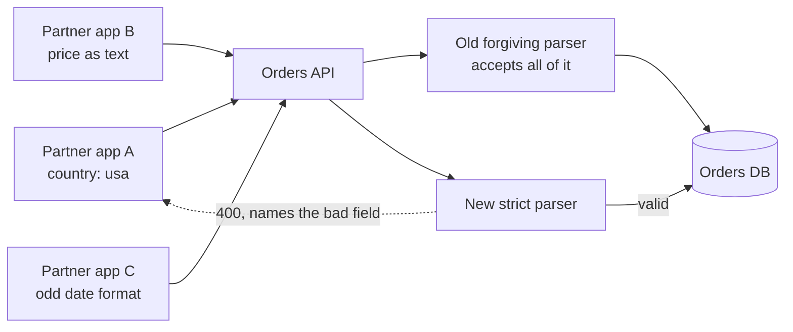

# Postel's Law

> Be strict in what you send and forgiving in what you accept. It helped the early internet's mismatched machines talk to each other, and taken too far, it turns everyone's bugs into permanent features.

## How it works

Jon Postel, who edited the specs for IP and TCP, put it in RFC 760 and RFC 761 in January 1980 and kept it in RFC 791 and RFC 793 in 1981. The TCP version says "be conservative in what you do, be liberal in what you accept from others."

It's a two sided bargain. When you send, follow the spec to the letter. When you receive, tolerate small mistakes if the meaning is still clear. In 1980, when TCP stacks were hand written for many different kinds of computers, that kept the network talking instead of dropping a connection over one odd flag.

The trouble shows up years later. If every receiver forgives a mistake, the sender never learns it made one. Other senders copy it, and now the mistake is the real protocol. Every new implementation has to accept it too, matching old bugs exactly. RFC 9413, published by the Internet Architecture Board in 2023, makes this case and argues that a protocol that is still actively maintained should do the opposite: reject bad input clearly, so bugs surface early and get fixed where they live.

Forgiving parsers also cause security holes. When two systems forgive in different ways, an attacker can craft one message that each of them reads differently. HTTP request smuggling works like this: a proxy and the server behind it disagree about where one request ends and the next begins, so the attacker sneaks a second request past the proxy's checks.

Watch out: forgiveness is not a design. If you do accept a sloppy input, log it, tell the sender, and set a date when you stop accepting it.

## Example

An online store has a public orders API for partner apps. Version 1 was forgiving: `"US"`, `"usa"`, and `"United States"` all worked as a country, prices could be numbers or strings, and dates came in four formats. Partners integrated fast without reading the docs.

Three years and 300 partners later, the team rewrites the orders service with a strict JSON schema. They try it as a canary release, with 5% of traffic on the new code. In the first hour, 18% of the partner requests it sees fail. Every quirk the old parser forgave is now load bearing. The team ends up writing a compatibility layer that copies the old parser's mistakes one by one.

The cheaper path was strict from day one: return a `400` that names the bad field, and accept one format. Partners fix it once, during integration, when it costs them an afternoon.

```http
HTTP/1.1 400 Bad Request
Content-Type: application/json

{"error": "country must be a 2 letter ISO code, like US"}
```

## Picture it



Three partners lean on three different quirks, and the old parser forgave all of them. The new strict parser is correct and still breaks them, because the forgiveness had become the real contract.

## Related

[Hyrum's Law](hyrums-law.md) · [API Versioning](../05-apis/api-versioning.md) · [Serialization Formats](../05-apis/serialization-formats.md) · [Fail Fast](../24-principles/fail-fast.md) · [TCP vs UDP](../04-networking/tcp-vs-udp.md)
