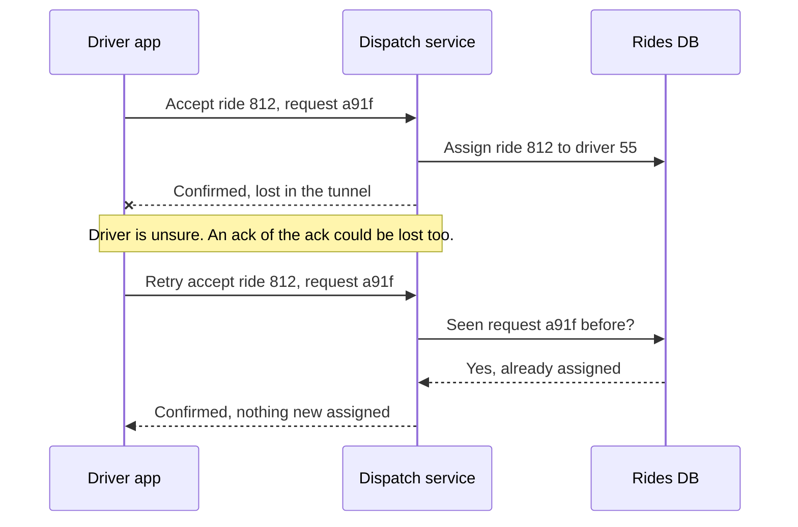

# Two Generals Problem

> Two machines talking over a link that can lose messages can never both be sure they agree. Every confirmation needs its own confirmation, forever, so real systems stop chasing certainty and make retries safe instead.

## How it works

Two armies sit on opposite hills with the enemy in the valley between them. They win only if they attack together, and the only way to talk is a messenger who might get caught. General A sends "attack at dawn". Did it arrive? A can't know unless B replies. But B can't know the reply arrived unless A replies to the reply. Whoever sent the last message is always left guessing, so no number of round trips makes both sides sure.

E. A. Akkoyunlu, K. Ekanadham and R. V. Huber described the problem in 1975, and Jim Gray gave it the two generals name in 1978. It's often called the first computer communication problem proven to have no solution.

Your services live on those hills. A client sends "charge $20" and the reply never comes. Maybe the request was lost. Maybe the charge went through and only the reply was lost. From the client's side, the two look exactly the same.

You can't remove the doubt, so you design around it:

- **Make repeats safe.** Send an idempotency key so a retry can't do the work twice.
- **Retry until you hear back.** With safe repeats, sending at least once gives the effect of exactly once.
- **Pick one source of truth.** Let the other side ask "what happened to request 812?" instead of guessing.
- **Accept a window of doubt.** Show "confirming" for a few seconds, and reconcile the rare leftovers later.

Watch out: adding a third or fourth acknowledgment feels like progress, but it only moves the uncertainty to the new last message.

## Example

A driver on a ride sharing app taps Accept on ride 812 just as the car enters a tunnel. The request reaches the dispatch service, which assigns the ride and replies "confirmed". The reply dies in the tunnel.

Now dispatch thinks the driver is coming, and the driver's app has no idea. If the app gives up, the rider waits for a car that isn't on its way. Making dispatch wait for a "got your confirmation" message wouldn't help, because that message could get lost too.

The fix: the app retries "accept ride 812, request a91f" every 2 seconds and shows "Confirming". Dispatch has already seen a91f, so it repeats "confirmed" without assigning anything twice. If dispatch hears nothing from the driver for 20 seconds, it reassigns the ride, and the app learns that the next time it connects. Not certainty, but every outcome is handled.

## Picture it

The lost reply leaves the driver unsure, and no extra acknowledgment can fix that. The retry with the same request ID makes the doubt harmless, because dispatch recognizes it and answers again without doing anything twice.

## Related

[Idempotency](../14-reliability/idempotency.md) · [Retries](../14-reliability/retries.md) · [Delivery Guarantees](../13-messaging/delivery-guarantees.md) · [Two Phase Commit](../11-coordination/two-phase-commit.md) · [Byzantine Generals Problem](byzantine-generals-problem.md)

---

[← PACELC](pacelc.md) · [All concepts](../../README.md) · [Byzantine Generals Problem →](byzantine-generals-problem.md)
