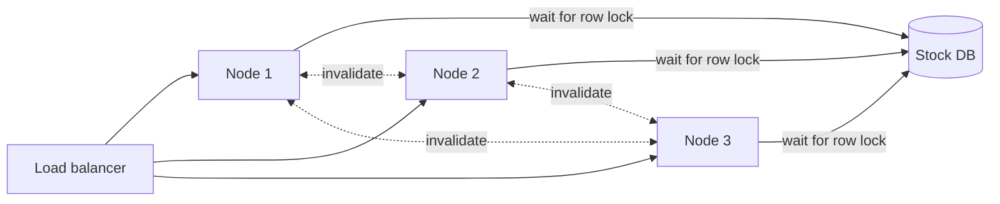

# Universal Scalability Law

> The Universal Scalability Law predicts what happens to throughput as you add servers. Waiting on shared things flattens the curve, servers syncing with each other bends it down, and past the peak more servers get less done.

## How it works

Neil Gunther, a performance analyst, introduced the model in 1993. It starts from perfect scaling, where 10 servers do 10 times the work of one, and subtracts two costs:

- **Contention (α, alpha).** Servers queue for something shared: one database row, one lock, one leader. This is the serial part from Amdahl's Law, and it makes throughput level off.
- **Coherency (β, beta).** Servers have to talk to each other to stay in sync: cache invalidations, gossip, handing locks around. Every pair of servers adds chatter, so this cost grows with roughly the square of the server count, and it makes throughput fall.

The formula is `C(N) = N / (1 + α(N - 1) + βN(N - 1))`, where `N` is the number of servers and `C(N)` is how many times more work they do than one server alone. With α and β both zero, you get a straight line. With β above zero, there's a peak at about `sqrt((1 - α) / β)` servers, which is about 10 when α is 0.05 and β is 0.01. Every server past the peak makes the whole cluster slower.

You get α and β by measuring. Load test at 1, 2, 4, and 8 nodes, fit the curve to the results, and you can predict 32 nodes without buying them.

Watch out: people treat "add more servers" as a dial that only goes up. When a cluster gets slower after scaling out, that's not bad luck, it's β. The fix is cutting the cross talk, like sharding so each node owns its own slice of data, not adding nodes.

## Example

An online store's inventory service keeps stock counts in a local cache on every node. Each update tells every other node to drop its copy. A load test at 1, 2, 4, and 8 nodes fits α = 0.05 and β = 0.01, with one node handling 1,000 requests a second.

The curve says 4 nodes handle about 3,150 requests a second and 10 nodes about 4,250. That's the peak. Before Black Friday, someone doubles the cluster to 20 nodes anyway, and throughput drops to about 3,480. They paid for 10 more servers and got 18% less work done.

The fix: shard the stock counts so each node owns a slice of products and never has to tell the others anything. β falls to almost zero, and 20 nodes now handle about 10,000 requests a second.

## Picture it

The solid arrows are contention: every node lines up for the same database row. The dotted ones are coherency: every pair of nodes chats. 3 nodes make 3 pairs, but 20 nodes make 190, and that chatter is what bends the curve down.

## Related

[Amdahl's Law](amdahls-law.md) · [Horizontal Scaling](../02-scaling/horizontal-scaling.md) · [Load Testing](../22-operations/load-testing.md) · [Capacity Planning](../22-operations/capacity-planning.md) · [Throughput](../01-performance/throughput.md)
