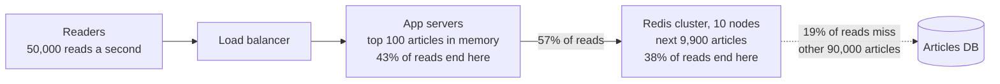

# Zipf's Law

> Zipf's Law says popularity falls off with rank: the second most popular item gets about half the traffic of the first, the third about a third. That's why a small cache catches most requests, and why a few keys run hot.

## How it works

Rank items by how often they're requested. Under Zipf's Law, the item at rank `k` gets traffic in proportion to `1 / k^s`, where `s` sets how steep the drop is, usually near 1. So rank 1 gets one full share, rank 2 gets half, rank 10 gets a tenth, and a long tail of items gets almost nothing each.

It's named after George Kingsley Zipf, a Harvard linguist who popularized it in the 1930s and 1940s by counting how often words show up in text. The same curve turns up in city sizes and in web traffic. A 1999 study of web proxy logs by Breslau and colleagues found requests follow a Zipf like curve, with the steepness varying from site to site.

What it means for your system, with 100,000 items and `s` = 1:

- **A small cache goes a long way.** The top 1,000 items get about 62% of requests, and the top 10,000 get about 81%. Cache a tenth of the catalog and 4 out of 5 reads never reach the database.
- **Returns shrink fast.** Doubling that cache to 20,000 items only lifts the hit rate from 81% to 87%.
- **The top key is hot.** Rank 1 alone gets about 8% of all traffic, and all of it lands on one cache node.

Watch out: hashing spreads keys evenly, not traffic. Under Zipf traffic, the node holding the top few keys works much harder than its neighbors, and adding nodes doesn't help because the hot key still lives in one place. Copy hot keys to several nodes, or keep them in a small in process cache on each app server.

## Example

A news site has 100,000 articles and serves 50,000 reads a second. Its Redis cluster holds the 10,000 most read articles, so about 81% of reads never touch the database, which sees roughly 9,500 reads a second instead of 50,000.

Then a big story breaks and its article jumps to rank 1: about 4,000 reads a second on a single key. Whichever Redis node holds the top key carries about double the load of the other 9, and at tonight's traffic that node starts timing out.

The fix: each app server keeps the top 100 articles in local memory for 5 seconds. Under the same curve, those 100 articles are about 43% of all reads, so nearly half the traffic never leaves the app servers, and the hot Redis node calms down.

## Picture it

Read it left to right as the Zipf curve. A tiny head of 100 articles absorbs 43% of reads in local memory, the next 9,900 take most of the rest from Redis, and the 90,000 article tail is all the database ever sees.

## Related

[Caching](../06-caching/caching.md) · [Hot Spots](../09-data-at-scale/hot-spots.md) · [Cache Eviction](../06-caching/cache-eviction.md) · [Pareto Principle](pareto-principle.md) · [CDN](../03-traffic/cdn.md)

---

[← Kingman's Formula](kingmans-formula.md) · [All concepts](../../README.md) · [Pareto Principle →](pareto-principle.md)
